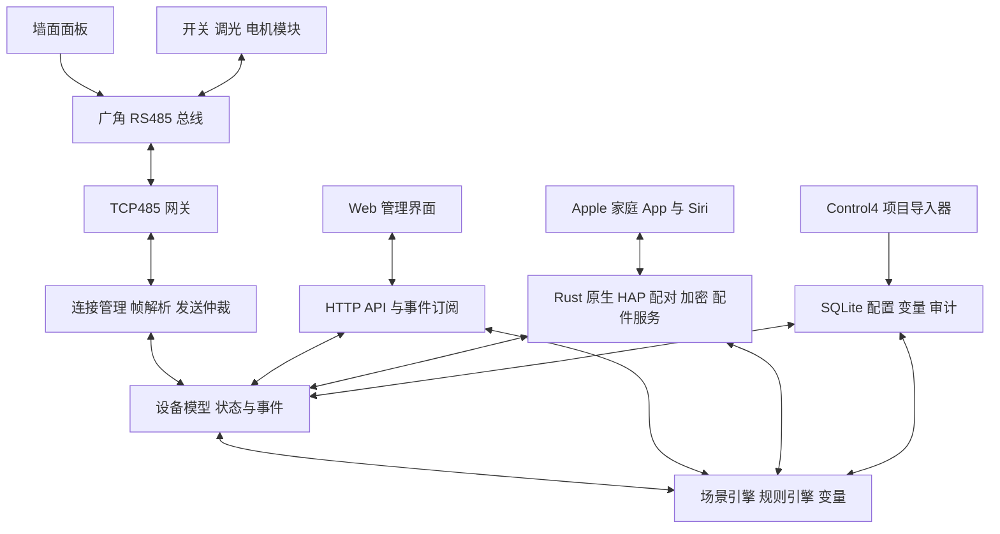

# Rust 家庭中控替代 Control4 EA-5 设计

版本 1.2，日期 2026 年 10 月 10 日。适用项目为 Charlie's 家庭中控，目标是在保留广角 RS485 模块、墙面面板和现场布线的前提下，使用 Rust 服务替代 Control4 EA-5 的灯光、窗帘、场景与事件逻辑。

本设计以 Charlies250801.c4p 的项目快照和广角产品手册为基线。协议已有实现依据，现有项目可离线导入；正式替换以现场型号核对、行为对照测试和分区验收通过为条件。设计中的服务、API、配置格式及性能数值均为待实现方案，不代表已经部署或已测得性能。

## 1 目标与功能边界

第一阶段交付完全在局域网运行的中控：支持物理面板操作、Apple「家庭」App 与 Siri 控制、浏览器维护、灯光开关与调光、窗帘升降停止、场景执行、条件与变量、运行诊断及备份恢复。互联网断开时，现场控制应继续工作。

系统保留可用的现有 TCP485 网关和 RS485 总线。Rust 服务主动连接网关，将逻辑设备命令转换成广角报文，并将反馈转换成可供界面和规则使用的事件。

| 功能 | 首期范围 | 交付条件 |
| --- | --- | --- |
| 56 路开关灯 | 开关、查询、反馈、场景联动 | 逐路确认地址与负载 |
| 40 路调光灯 | 亮度、渐变、查询、反馈 | 核对 8 通道模块型号与渐变表现 |
| 12 路窗帘 | 升、降、停与互锁配合 | 逐路确认方向；界面不伪造位置 |
| 28 个面板 | 按下、松开、LED 与按键映射 | 确认型号、键数和运行模式 |
| 68 个灯光场景 | 成员、延迟、亮度与渐变 | 对照原系统行为 |
| 215 个事件程序 | 转换支持的命令、条件和变量操作 | 所有未支持节点显式报告并处理 |
| SR-260 遥控器 | 另行评估 | 不纳入广角总线驱动验收 |
| Control4 App、媒体和音频 | 另行评估 | Apple 家庭 App 承担日常控制，Web 界面承担维护 |
| Home Assistant、MQTT、Matter | 预留适配层 | 核心中控稳定后单独实现 |

替代 EA-5 的首期含义是接管上述家庭控制功能，不自动包含其私有生态、媒体输出和全部第三方驱动。

## 2 现有项目基线

项目文件为 /Volumes/m4work/aiml/Control4/Projects/Charlies250801.c4p。归档内记录的快照时间是 2025-07-28 12:53:34；文件名中的日期不作为快照时间。项目记录 Composer 与 Director 版本 3.2.3，时区 Asia/Shanghai。

| 对象 | 数量 | 说明 |
| --- | --- | --- |
| 楼层与房间 | 3 层，27 个房间 | 地下室、第一层、第二层 |
| 灯光 | 96 路 | 56 路开关、40 路调光 |
| 窗帘 | 12 路 | 3 个电机模块，每个 4 组 |
| 面板 | 28 个 | 按键布局须核对实物 |
| 场景 | 68 个 | 包含 629 次成员引用，非 629 个设备 |
| 事件程序 | 215 个 | 解析统计 2170 个设备命令、396 个设备条件 |
| 项目变量 | 25 个 | 保留类型、初值与引用关系 |
| 连接关系 | 262 条 | 需从代理对象追踪到实际驱动 |
| 项目对象 | 309 个 | 包括代理、房间和代理服务，不等于实物数量 |

已提取 136 个广角对象的地址映射，共 43 个总线地址。开关模块地址为 01 至 07；调光模块为 11 至 15；电机模块为 21 至 23；面板另占 28 个地址。地址均为十六进制。当前离线映射未发现跨类型地址冲突，现场仍须验证实际拨码和总线是否一致。

项目中的网关 IP 是 192.168.0.10，广角网关驱动端口是 50007。正式连接前核实现场网关当前地址、TCP 模式和串口参数。nanopc 当前作为路由器候选运行宿主时，必须先验证到该网关网段的路由及防火墙放行；不能假定不同网段天然可达。

## 3 核心架构

系统采用一个 Rust 常驻进程，内置原生 HomeKit HAP over IP 服务，并提供静态 Web 管理前端。Apple 家庭 App 是日常控制入口；HAP 接入模块直接调用中控的类型化命令入口并订阅状态，不经过独立桥接进程或本机 HTTP 转发。每条物理总线由一个独占的网关任务维护连接和发送队列；HAP、Web、场景和规则使用同一套命令仲裁，避免不同来源绕过仲裁直接写总线。



网关任务拥有 TCP socket。其他模块通过有界消息通道提交命令；接收反馈形成统一事件。状态修改由集中状态任务排序，规则读取事件对应的状态版本。数据库写入通过独立任务批处理，不阻塞按键接收和 STOP 命令。

部署只保留一个有写权限的中控实例。待机或观察实例禁止执行规则与发送控制命令。网关可能允许多个 TCP 连接，这并不提供控制权仲裁；切换期间要在服务和网络层共同保证单一控制者。

## 4 Rust 模块设计

采用独立 Cargo workspace，不混入 rproxy 的代理业务。代码路径在实施时确定，配置与运行数据不放在源码树。

| 模块 | 职责 |
| --- | --- |
| home-core | 稳定设备 ID、命令、事件、状态、错误类型与时间抽象 |
| gj-protocol | 5 字节帧编解码、地址校验、分包粘包与未知帧分类 |
| gj-transport | TCP 连接、重连、队列、限速、查询调度与总线仲裁 |
| home-state | 状态版本、已观测与期望状态、快照和订阅 |
| home-scenes | 延迟、渐变、取消、设备冲突与执行结果 |
| home-rules | 条件 AST、变量、按键手势、事件防循环和执行预算 |
| c4-import | 安全读取项目归档、建立映射、转换和迁移诊断 |
| home-storage | SQLite schema、事务、备份、配置版本和变量持久化 |
| home-hap | HAP over IP 配对、加密会话、配件数据库、特征读写、事件通知与 mDNS |
| home-api | 身份验证、HTTP 接口、WebSocket 事件与权限检查 |
| home-daemon | 进程入口、配置加载、信号处理、健康状态和 systemd 集成 |
| home-simulator | 可重复的网关模拟器、虚拟时钟和迁移回放 |

异步运行时、HTTP 框架、序列化、数据库访问、结构化日志可以分别使用 Tokio、Axum、Serde、SQLite Rust 绑定和 tracing。这些是候选实现选择，具体版本与依赖在实施时核对官方文档并锁定 Cargo.lock。核心协议库保持无网络依赖，便于单元测试与复用。首期不引入运行时脚本插件和分布式微服务。 原生 HAP 优先对 hap-rs 做编译、依赖安全和实际 Apple 配对验证，协议依赖封装在 home-hap 内，固定经验证的版本或提交。库的存在不代表已满足全屋桥接、错误处理和长期运行要求；必要修复维护在受控分支，配对和加密原语不自行设计。

## 5 设备模型与地址

为每个房间、逻辑设备、场景和规则分配稳定的内部 ID。Control4 对象 ID、驱动 ID 和广角地址作为来源映射保留，不作为可变名称。代理对象与驱动对象通过连接关系合并到同一逻辑设备，防止场景引用代理而控制不到实际通道。

设备地址由 gateway_id、十六进制 bus_id 和 channel 组成。面板包含按钮子对象，模块地址在同一物理总线上必须唯一；开关和调光同一模块的不同通道允许共享地址。不同总线可以使用相同地址。

能力字段至少包含 switch、level、motor、button_events、led、state_query 和 feedback。类型与通道上限来自经过确认的型号。项目中调光地址 11 至 15 均映射了 8 路，不能按 4 路 GT-E4 配置。面板项目含 Rocker 类型，不能仅凭 BT-86 手册把所有面板固定为 6 键。

```json
{
  "schema_version": 1,
  "device_id": "light-basement-corridor-15-1",
  "name": "过道15-1",
  "room_id": "basement-leisure",
  "kind": "dimmer",
  "address": {"gateway_id": "gj-main", "bus_id": "15", "channel": 1},
  "capabilities": ["level", "state_query", "feedback"],
  "source": {"system": "control4", "driver_id": "362", "proxy_id": "363"},
  "model_verification": "pending"
}
```

示例格式为设计格式。bus_id 强制采用两位十六进制字符串；导入器不得将 "15" 当作十进制 15。通道、亮度、地址冲突和不存在的引用在配置发布前检查，错误配置不能进入执行状态。

## 6 广角协议与驱动

普通控制帧为 5 个原始字节：AE ID CMD VALUE EE。文档中的十六进制表示法不是 ASCII 文本。串口参数为 9600 baud、8 数据位、无奇偶校验、1 停止位；这类普通帧没有文档定义的校验和。ID=00 是广播，常规 API 禁止使用。

以下 c 表示通道；A0+c、B0+c、D0+c 表示字节加法，亮度为十进制 0 至 100 的字节值。

| 类型 | 动作 | CMD | VALUE |
| --- | --- | --- | --- |
| GT-C8 开关 | 开／关 | c | F1／F2 |
| GT-C8 开关 | 查询 | A0+c | F2 |
| GT-C8 开关 | 状态反馈 | D0+c | F1／F2 |
| 调光模块 | 立即设置 | c | level |
| 调光模块 | 模块渐变 | B0+c | level |
| 调光模块 | 查询 | A0+c | F2 |
| 调光模块 | 亮度反馈 | D0+c | level |
| 调光模块 | 暂停渐变 | A0+c | 05 |
| GT-M4 电机 | 升／降／停 | c | F1／F2／F0 |
| BT-86 面板 | 按下／松开反馈 | D0+c | F1／F2 |
| BT-86 面板 | LED 开／关 | c | F1／F2 |

例如地址 15 的第 1 路调光设为 30%，发送 AE 15 01 1E EE；地址 05 的第 2 路开关关闭，发送 AE 05 02 F2 EE。

反馈按地址对应的设备类型解释。AE ID D1 F1 EE 对开关是开状态，对面板是第 1 键按下。未知地址不能自行推断为开关或触发规则。GT-M4 手册只定义动作，不提供百分比位置反馈。面板 LED 接受命令依赖其手动模式，切换模式和其他模块参数不在普通操作接口中开放。

TCP 输入使用累积缓冲区处理任意分包和粘包，寻找 AE 后按固定 5 字节验证 EE；错误候选逐字节重新同步，并限制缓冲区大小。数据字节可能为 AE 或 EE，不能遇到 EE 就截断。语法合法但类型或值未知的帧进入诊断日志，不产生自动化事件。

CC 固件查询返回 ASCII，与普通帧格式不同。首期驱动不在状态轮询中使用该命令；后续支持时设专用维护模式和独立解析策略。未知帧和短路噪声不能被当作设备状态。

## 7 网关连接与命令可靠性

连接状态依次为 Disconnected、Connecting、Synchronizing、Ready；连续失败进入 Degraded。连接成功后先恢复帧接收，再分批查询可查询设备，最后开放依赖状态的自动化。重连采用指数退避和随机抖动，初始设计上限 30 秒。

发送队列优先级为 STOP、人工即时控制、按键规则、场景、后台查询。优先级只能重排尚未写入 socket 的命令，不能撤回网关已缓存的字节。同一设备的动作保持约束顺序；窗帘换向的 STOP 与后续动作作为受约束序列执行。

队列必须有容量上限、过期时间和来源标识。调光滑块产生的连续立即设置可以合并为最新值；STOP、按键事件、变量操作和规则节点不能任意合并。取消场景删除其尚未发送的动作，后续迟到反馈仍用于更新真实状态。

5 字节在 9600 baud、8N1 下理论串口占用约 5.2 毫秒，不含网关与设备延迟。初始发送间隔配置为 20 毫秒，属于保守调试值，不是厂家要求；根据现场丢帧和响应数据调整。该设置下 96 条命令至少需要约 1.92 秒，不能要求全屋 96 路同时完成。

协议没有请求序号和通用 ACK。执行状态必须区分 queued、written、observed、timed_out、cancelled、failed。written 只说明本地写入传输层，不证明负载动作完成；灯光通过同地址同通道反馈进行状态核验，仍不能证明反馈只来自本次命令。LED 和电机没有已确认的通用执行 ACK，只记录已发送与验证能力。

确定目标值的灯光操作可在查询后有限重试；TOGGLE 等相对操作、电机动作和规则整体禁止自动重放。网络中断后清空过期控制队列，不在重连时突然执行旧场景。使用绝对开关目标代替硬件 toggle，可以减少不确定重试。

后台查询合并相同通道请求，限制并发，避免多个任务对同一反馈等待。默认每个通道设置可调查询超时，首轮按 1 秒调试；场景拥塞时延后查询，连续失败降低频率。主动反馈、全模块查询、回包顺序和多连接行为均须现场验证后启用。

## 8 状态一致性与断电恢复

每个可控属性保存 desired、observed、quality、source、observed_at、version 和 pending_command。quality 至少包括 unknown、confirmed、stale、estimated。UI 优先展示 observed；发送命令后可以展示等待提示，但不能立刻标记 confirmed。

灯光状态以有效反馈确认。反馈来自现场面板或其他本地联动时也更新状态。重复的相同值反馈更新观测时间，不重复产生状态变化事件，避免轮询触发规则循环。

窗帘保存 last_command 和动作时间。未安装位置传感器时，真实 position=null；如果用户完成行程校准，可另外显示 estimated_position，并明确标记估算。重启、掉电、通信故障或现场手动干预后估算失效。首期 UI 使用开、关、停按钮，方向通过校准映射。

运行状态快照用于故障分析，不能在重启后作为已确认现场状态。持久化的场景变量与设备观测分开：逻辑模式可以恢复，物理状态重新查询，条件遇到 unknown 不执行需要确定状态的动作。

恢复流程为加载配置、检查 schema、恢复变量、建立连接、查询灯光、发布状态就绪、开放相应规则。面板断链时取消未完成的长按计时器；连接恢复不能补发“曾经按下”的动作。

## 9 场景引擎

每个场景包含稳定 ID、成员动作、延迟、目标亮度、渐变时长、执行顺序、失败策略和冲突策略。导入同时保留原始 track_level、delay、rate、level 字段；这些字段的具体语义必须结合驱动与原系统行为校验，不能仅凭名字直接对应。

所有延迟相对单调时钟的场景开始时间计算。相同到期时间保留源配置顺序，经总线队列逐条发送。场景是有时序的动作集合，RS485 协议不提供跨设备事务；部分成员失败时报告 partial，首期不自动反向补偿已成功动作。

立即控制、模块自身渐变和软件渐变作为三种能力区分。模块的 Bx 命令使用其内部渐变设置；原项目的 Ramp Timer 与场景 rate 不能直接放进报文。需要精确时长时，可通过软件定时输出分段亮度，但必须计算总线预算、合并采样并接受实际完成误差。首期优先采用经验证的模块渐变，再覆盖有明确时长要求的少量场景。

人工控制默认取消该设备在当前场景中的剩余动作，其他设备继续；新场景覆盖同一设备的旧目标，记录冲突原因。STOP 始终优先。调光模块自身正在渐变时，新目标或取消操作是否应先发送暂停命令由实测行为确定。

场景 active 由成员目标与可观测状态的匹配结果计算；同时保留 last_run 和 run_status。缺少反馈、仍在渐变或成员失败时显示 pending 或 unknown，不能只因命令已发就显示场景已达成。DEACTIVATE_SCENE 的原始语义要在导入时查明，不能统一转换成全部关灯。

原项目“卧室-全开”包含两路开关全开和两路调光到 14%，调光元素的 rate 为 1000。名称不等于所有成员都到 100%；转换保留实际元素，并将 1000 的单位和执行行为列为对照测试项。

## 10 事件规则与面板操作

规则结构包含 trigger、condition AST、actions、变量读写、启用状态、执行预算和来源节点。采用类型化语法树，保留嵌套层级、顺序和 Else 分支，不将原程序压平成命令列表。

主要事件包括按键按下、松开、单击、双击、长按开始、长按释放、灯光状态变化、变量变化、场景执行结果、启动同步完成和计划任务。手势时间使用单调时钟，时区只用于日历计划。

首期手势参数设为可配置值：重复边沿抑制 30 毫秒、长按阈值 600 毫秒、双击窗口 300 毫秒，均为待调试值。产生双击时是否同时产生单击由按键配置确定；存在双击动作的按键默认延后单击，不能先执行单击后再无条件执行双击。按下即执行与单击执行分别建模。

长按调光每个面板和通道只允许一个活动任务，松开立即取消。丢失松开时通过最长运行时间中止，初始上限 10 秒；总线断链同样取消。摇杆面板需要明确上、下键及方向，不通过未经确认的键号猜测。

规则执行时先读取一致的状态版本，变量修改按序处理。不同规则对同一设备的输出由命令仲裁决定。规则链保留 correlation_id 和 causation_id，检测重复路径并限制深度、动作数与运行时间；超预算停止该链并记录诊断，不使整个中控崩溃。

25 个项目变量分为逻辑模式、临时执行状态和设备状态缓存。逻辑模式可持久化；临时执行状态重启清空；缓存状态以反馈刷新。条件求值采用 true、false、unknown 三值逻辑。遇到 unknown 时跳过该条件的整个分支并记录诊断，不执行 Then 或 Else，也不把 unknown 当作 false 或亮度 0；只有显式检测未知状态的规则可以处理该情形。

面板 LED 可绑定场景状态、模式变量或设备状态。原项目显式 LED 动作优先保留，统一状态绑定仅在确认行为一致后替代。面板模式、背光与模块主动反馈参数放入维护配置，不在规则中自动改写。

## 11 Control4 项目迁移

导入流程为归档检查、XML 与驱动描述解析、对象和连接映射、设备规范化、场景转换、事件转换、引用检查、覆盖报告、模拟回放、生成待发布版本。导入器不执行压缩包中的 Lua，不绕过加密驱动授权；控制能力依据公开厂家协议重新实现。

读取归档限制文件数、解压后大小和 XML 深度，拒绝路径穿越；忽略未需要的二进制内容，XML 禁用外部实体。授权密钥、账号和令牌不进入规范化配置、日志或导出报告。

命令分发必须同时检查设备类型和命令参数。例如 Turn On/Turn Off 在面板对象上可能控制 LED，在灯光对象上则控制负载，不能按命令名称统一处理。SET_LEVEL、SET_LEVEL_TARGET、RAMP_TO_LEVEL、STOP、ACTIVATE_SCENE 与变量更新分别建立转换器。

导入产物至少包括 devices、rooms、scenes、rules、variables、source_map、unsupported_nodes 和 validation_report。每个转换结果追踪到原始对象、事件和节点，便于回查。未支持节点导致对应规则处于 disabled_pending，而不是静默丢弃后启用。

覆盖报告按原始对象和语法节点统计 converted、needs_review、unsupported、invalid；保留原始统计口径，不能把“解析出 2170 个命令”表述为“2170 个命令已经兼容”。计划任务也应检查：当前提取的 4 项主要是系统代理更新，不能当作家庭照明任务直接迁移。

对照回放使用原项目事件树和已确认的预期结果建立样例。至少覆盖每个房间的常用面板、全开全关、重复按键、窗帘停、场景覆盖、变量分支及 LED 同步。没有原驱动执行语义的节点须用现场行为或人工确认补齐。

## 12 配置和数据存储

配置分为静态设备定义、自动化定义和运行参数。SQLite 保存经过验证的配置版本、活动版本指针、变量、迁移映射、场景运行记录和操作审计；TOML 保存服务启动、网络监听和存储路径。敏感凭据使用独立受限文件或系统凭据机制。

配置编辑在 draft 版本中进行。发布先完成类型、范围、地址唯一性、引用、规则预算和总线容量检查，再用事务切换活动版本。正常名称或规则修改可以热更新；网关地址和总线结构修改通过显式维护流程重建连接。已运行场景继续使用自己的配置快照或明确取消，不能混合两个版本。

数据库采用单写入任务、事务和 schema 迁移。备份使用 SQLite 一致性备份机制；不能直接复制正在使用的数据库主文件而遗漏 WAL。建议每日备份及每次配置发布前备份，保留策略可配置，初始保留最近 30 日和最近 20 个发布版本。

审计默认保留 30 日。原始总线报文日志只在诊断模式启用，并限制文件大小和保留时间，避免闪存持续写入。崩溃后数据库恢复不能回放历史动作。

## 13 API 和权限

所有控制来源使用统一 API 语义。浏览器界面与外部适配器不得直接访问 TCP485。HTTP 写请求具备鉴权、权限、参数校验、request_id、幂等键及结果查询。

| 接口 | 用途 |
| --- | --- |
| GET /api/v1/rooms | 房间和楼层 |
| GET /api/v1/devices | 定义、能力及状态 |
| POST /api/v1/devices/{id}/commands | 开关、亮度、电机或 LED 操作 |
| POST /api/v1/scenes/{id}/runs | 启动场景 |
| POST /api/v1/runs/{id}/cancel | 取消剩余动作 |
| GET /api/v1/runs/{id} | 执行结果与失败成员 |
| GET /api/v1/diagnostics | 网关、队列、同步与错误 |
| GET /api/v1/config/versions | 管理员查看配置版本 |
| POST /api/v1/config/versions/{id}/activate | 验证后发布 |
| GET /api/v1/events | 经鉴权的 WebSocket 订阅 |
| GET /health/live 与 /health/ready | 进程存活与设备服务就绪 |

控制请求通常返回 202 和 command_id，只表示已接收。队列满返回 429 或 503；值越界返回 422；设备未具备能力返回明确错误；网关离线的普通动作默认拒绝，不积压到恢复时执行。

```json
{
  "request_id": "client-request-001",
  "action": "set_level",
  "level": 30,
  "transition_ms": 1000,
  "expires_in_ms": 2000
}
```

transition_ms 只在设备或软件渐变能力已启用时接受；不支持则明确拒绝，不能忽略。重复的幂等键必须返回同一执行记录；相同键配不同内容返回冲突。窗口大小与过期策略配置化，进程重启后的重复请求也不能无条件执行相对动作。

事件带递增序号、状态版本、事件类型和来源。订阅客户端断线后请求最新快照，若服务不能补齐历史则返回 resync_required，不要求 UI 凭丢失事件继续推断状态。

角色分为家庭成员、访客和管理员。家庭成员操作允许的房间；访客受房间和场景范围限制；管理员配置和诊断。浏览器使用受保护会话、来源检查和 CSRF 防护；外部令牌可撤销并限定范围。首期不开放公网端口；Apple 家庭 App 的远程访问使用其家庭中枢机制，Web 管理远程访问使用受控 VPN。Apple 家庭权限与 Rust API 权限分别管理，原生 HAP 会话只允许操作已公开设备和场景，不暴露配置发布接口。HAP 配对控制器标识用于会话鉴权和审计，不能直接等同于某位 Apple 家庭成员。

## 14 Apple 家庭 App 与管理界面

Apple 家庭 App 按房间组织日常控制，在配对后由用户确认房间归属；Web 管理界面按地下室、第一层、第二层和房间组织，提供常用场景、当前灯光状态与快捷全关。Web 房间页显示开关、亮度滑块、窗帘开关停和可用场景；滑块交互在客户端与服务端共同限制频率。

控制后显示等待、已观测或失败，未知与离线状态清楚可见。窗帘只显示经过校准的开、关、停和动作记录；位置估算如启用，必须带估算标记。场景执行页列出失败成员，让用户能够知道哪些负载没有确认响应。

实体面板与 Apple 家庭 App 共同承担日常操作；Web 界面用于配置、校准、迁移和诊断。诊断页只向管理员显示总线地址、反馈时间、队列长度、重连次数、规则链和迁移异常。普通用户界面不暴露十六进制命令、配置版本或数据库字段。

前端静态资源与后端同源提供，避免首期额外跨域认证。兼顾手机竖屏、平板和桌面，断网时保留本地资源；所谓离线运行仍依赖家庭局域网和中控服务可达。

## 15 部署与网络

候选宿主为 nanopc，采用原生 Linux systemd 服务。若其继续承担家庭路由，控制服务必须使用独立账户、资源限制和独立数据目录；中控升级不得修改 PPPoE、rproxy、rdhcpd、OSPF 或现有路由配置。路由与中控共享宿主会增加共同故障风险，可在稳定后迁移到独立设备而保持配置兼容。 原生 HAP 与中控一起运行，无需部署独立 Node.js 服务；HAP 监听器、Web API 和广角连接分别绑定明确的接口与端口，资源预算包含加密会话及事件订阅。

建议部署目录：/usr/local/bin/home-gateway、/etc/home-gateway、/var/lib/home-gateway 和 /var/log/home-gateway。运行账户 home-gateway 不拥有网络管理权限，不以 root 常驻；TCP485 接入不要求串口特权。日志优先交给 journald。

systemd 配置采用 Restart=on-failure、启动频率限制、NoNewPrivileges、受限写目录、内存和 CPU 预算；具体沙箱选项在目标系统验证。接收 SIGTERM 后停止接单、取消尚未发送动作、保存变量并关闭连接；不能把“进程退出发送 STOP”当作窗帘安全保证，因为链路可能已经断开。

监听优先绑定管理 LAN 地址，避免意外监听 PPPoE/WAN。允许家庭管理网访问 API，仅允许中控连接网关 50007；远程管理通过经过授权的现有管理通道。网关位于 192.168.0.10 时，应验证路由、返回路径及网关默认路由。

时间使用系统时钟同步，日历任务按 Asia/Shanghai 运行；动作延迟和手势使用单调时钟，NTP 跳变不能延长窗帘动作或重复执行场景。局域网 DNS 名称在部署时确定，不在设计阶段修改现有记录。

## 16 可用性与故障处理

| 故障 | 系统行为 | 恢复条件 |
| --- | --- | --- |
| TCP 网关离线 | 标记状态 stale，拒绝普通新动作，取消过期队列 | 重连并重新同步 |
| 反馈缺失 | 执行超时，保留未知或旧观测，不伪造成功 | 查询或人工核对 |
| 单个规则异常 | 停止该规则链并记录来源 | 修复配置后重新启用 |
| 队列拥塞 | 低优先级查询退让，保留 STOP 容量 | 流量回落或定位循环 |
| 数据库写失败 | 标记 degraded，禁止配置发布，报告持久化失败 | 存储恢复并验证 |
| 磁盘不足 | 停止诊断报文留存，清理可轮转日志 | 释放空间后恢复 |
| 服务崩溃或重启 | 不回放旧动作，重新查询状态 | 同步完成后开放规则 |
| 宿主断电 | 使用模块既有硬件行为，恢复后重同步 | 宿主与网关恢复供电 |

在数据库失效时，允许内存中现有设备配置维持有限手动控制；依赖持久化变量的规则停用，界面明确告知当前状态。是否启用此降级模式作为部署配置，不静默切换。

现场模块手动按钮、面板本地联动和中控离线后的行为必须逐项实测。不能假定墙面面板在 EA-5 和新中控均离线时仍能控制全部负载。电机安全最终依赖现有互锁和输出时限，软件 STOP 是补充措施。

## 17 监控与性能目标

记录网关连接状态、重连次数、解码错误、未知地址、队列长度、排队时间、反馈延迟、查询超时、按键事件丢失、规则循环、场景 partial 数和数据库错误。结构化日志按 request_id、command_id、run_id、rule_id 和原始项目节点关联。

以下为验收目标，现场负载测试后调整，不是现有系统实测结果。

| 指标 | 初始目标 | 测量边界 |
| --- | --- | --- |
| 按键反馈进入服务至控制帧写出 | 正常低负载 P95 不超过 150 毫秒 | 不含人体操作至网关接收延迟 |
| 普通 API 接收请求 | P95 不超过 100 毫秒 | 不含负载完成时间 |
| STOP 排队 | 低负载 100 毫秒内调度 | 不含网关已缓存数据 |
| 无丢包的长时间运行 | 连续 72 小时无进程异常与未解释动作 | 同时审计日志和现场行为 |
| idle 资源 | 内存预算初始 150 MiB，平均 CPU 低于单核 5% | 实际在目标硬件测量 |
| 故障恢复 | 网络恢复后重连并完成状态同步 | 依设备数和总线预算确定时限 |

全屋场景不承诺同时切换。观测指标应区分输入延迟、排队延迟、TCP 写入、反馈和负载视觉响应，否则无法定位网关缓存或总线瓶颈。

## 18 测试与验收矩阵

测试采用协议库单元测试、虚拟网关集成测试、项目导入与规则回放、真实硬件小范围联调、分房间验收和整屋稳定运行五层验证。

| 层级 | 必测项目 | 通过条件 |
| --- | --- | --- |
| 协议 | 已知手册向量、边界亮度、十六进制地址、分包粘包、噪声、AE/EE 数据字节 | 精确编解码；未知帧不触发规则 |
| 传输 | 超时、断链、慢写、过量输入、重连、队列满 | 有界内存；不重放过期或相对动作 |
| 状态 | 迟到与重复反馈、未确认状态、重启、轮询回包 | confirmed 只来自有效观测；变化事件不重复 |
| 场景 | 96 路容量、取消、重叠、延迟、渐变、partial | 顺序与仲裁可解释；失败成员可追踪 |
| 规则 | 嵌套条件、Else、变量、双击、丢失松开、循环 | 对照样例一致；预算限制有效 |
| 导入 | 136 对象、68 场景、215 程序、代理绑定、敏感字段 | 全部引用可解析；所有未支持节点有处置 |
| API | 鉴权、越权、幂等、过期、事件断线 | 未授权命令不执行；客户端可恢复一致状态 |
| HAP | 实机配对、加密会话、读写、事件订阅、权限、稳定 AID/IID、多客户端、重启 | 家庭 App 操作与反馈一致；未配对会话不能控制；备份恢复后不产生重复配件 |
| 部署 | 存储满、进程重启、掉电、升级回退、路由共存 | 数据可恢复；既有网络服务稳定 |

真实设备验收按房间形成清单：设备名称与负载正确、每个按键短按长按正确、LED 正确、灯光状态正确、调光平稳、窗帘方向与 STOP 正确、场景成员及变量分支正确。验收过程中记录命令与反馈，涉及真实负载的动作先在该房间安排可控测试时段。

最终门槛为 136 个导入对象映射核实、68 个场景逐项处置、215 个事件程序逐项处置；迁移范围内无静默丢失节点。刻意不迁移的功能必须列入明确排除清单，不能用整体覆盖百分比掩盖关键功能缺口。

## 19 切换与回滚

切换分为离线准备、观察模式、测试房间、分区接管、整屋接管和稳定运行。观察模式只接收和记录反馈，禁止执行规则与控制命令；若新增 TCP 连接会改变网关行为，则停止并改用离线回放或受控维护窗口。

先备份原项目、网关网络参数、模块设置、nanopc 服务配置和可恢复的旧中控状态。新中控的设备地址、方向和面板模式必须完成登记，不能通过广播修改来省略逐模块核对。

试运行房间在 EA-5 中禁用对应自动化，确保该房间只有一个执行者，再启用新中控相应规则。分区时还要检查全屋场景和跨房间规则，避免旧中控间接写入已接管负载。测试结束可恢复旧系统对应功能。

整屋切换时停用 EA-5 的相关规则并断开其广角控制连接，再启用新中控正式写入模式，重新同步灯光并执行验收。不要在“仍然都能连接网关”的条件下让两个控制器竞争。

回滚触发包括常用按键失效、窗帘无法可靠停止、持续反馈异常、关键规则未转换、宿主路由受到影响。回滚顺序为禁止新接单、停用规则、清理未发送动作、关闭新网关连接、恢复 EA-5 连接与规则、核对灯光和窗帘现场状态。已发出的物理动作不能由软件事务回滚，必要时人工恢复。

数据库升级采用兼容检查和备份；代码回退不得直接打开不兼容的新 schema。升级包与配置版本绑定记录，先验证恢复能力再删除旧版本。

## 20 实施阶段与交付物

| 阶段 | 实现内容 | 可审查交付物 |
| --- | --- | --- |
| A 离线基础 | 广角协议库、设备导入、模拟网关、原生 HAP 虚拟调光灯原型 | 编码测试、覆盖报告、iPhone 配对与重启保持配对记录 |
| B 只读联调 | TCP 连接、状态查询、反馈分类 | 地址核对表、延迟与回包记录 |
| C 单设备控制 | 开关、亮度、电机、LED、仲裁 | 逐设备验收和方向校准记录 |
| D 自动化迁移 | 场景、变量、条件 AST、手势 | 68 场景和 215 程序处置清单 |
| E 用户界面 | 原生 Rust HAP 配件公开、场景入口、Web 管理、鉴权 | 配对、反馈、Siri、断线恢复与权限测试 |
| F 正式部署 | systemd、备份、监控、升级 | 部署说明、恢复演练、72 小时运行记录 |
| G 接管 | 分区与整屋切换 | 签认的房间验收、回滚演练和剩余问题 |

阶段 B 以前无需接管现场动作。阶段 C 开始按房间联调；阶段 G 以前维持可恢复的 EA-5。开发时间在完成阶段 A 的节点语义盘点后估算，避免在未统计兼容缺口前承诺固定工期。

## 21 待确认事项与设计决策

| 事项 | 当前依据 | 对实施的影响 |
| --- | --- | --- |
| 现场网关型号及模式 | 项目 192.168.0.10:50007；TCP485 手册 | 确认透明传输和安全接入 |
| 8 路调光模块型号 | 地址 11 至 15 每个 8 路 | D8、L8 等实物与负载方式核对 |
| 面板类型和键数 | 28 个地址，项目含 Rocker | 事件键号和 LED 布局逐个核对 |
| 主动反馈模式 | 手册有配置项 | 先轮询，不自动改写参数 |
| 场景 rate 与 Ramp Timer | 原项目字段存在 | 用对照测试验证渐变时长语义 |
| 场景停用和事件 ID 语义 | 原始树和驱动描述可追踪 | 明确转换器和验收样例 |
| 电机方向、时限、行程 | 手册只有升降停 | 校准；不宣称真实百分比位置 |
| nanopc 到网关的网络路径 | 不同网段的部署候选 | 验证路由与返回路径 |
| 控制服务与路由共宿主 | nanopc 已承担网络服务 | 资源隔离；评估独立宿主 |
| SR-260、音频与其他外设 | 超出广角协议 | 单独决定保留或替代 |

已确定的设计决策为：采用单进程模块化 Rust 服务，原生 HAP over IP 接入 Apple 家庭；保留广角总线；统一命令仲裁；设备观测与控制意图分离；使用类型化规则树；不静默忽略导入缺口；只有一个正式控制者；重连不重放旧动作；以房间验收支持渐进替换。

## 22 资料与追踪

项目资料：Charlies250801.c4p，路径 /Volumes/m4work/aiml/Control4/Projects/Charlies250801.c4p。基线设备、房间、场景与事件数量来自该项目的离线解析，现场可能已在此快照之后变化。

厂家资料目录：/Volumes/m4work/aiml/Control4/广角智能产品资料包 2021-6-10/产品手册。协议依据分别是 GT-C8-RL 产品手册 Ver2.8.2-2、GT-E4-RL 产品手册 Ver3.2.2-2、GT-D8-RL 产品手册 Ver2.2.6-2、GT-L8-RL 用户手册 Vev2.0.7-2、GT-M4-RL 产品手册 Ver2.1.9-2、BT-86-C(RS485) 用户手册 Ver2.9.6-2，以及“其它”目录中的 TCP485-DIN 使用手册 Ver2.4.4。

离线附件为 Charlies250801.parsed.json、Charlies250801.report.txt、GJ-device-map.json 和 GJ-protocol-notes.txt，位于本次任务的 control4 资料目录。它们分别用于保留原始结构、人工审阅、地址映射和协议核对。附件中的配置格式不表示驱动已实现。

实施时每个转换规则、设备校准和现场验收都应关联原始项目对象及配置版本，使未来修改可以解释其来源和影响。

## 23 Apple 家庭 App 接入设计

日常使用 Apple 家庭 App 控制设备和运行常用场景，Siri 作为语音入口。Rust 中控继续负责现场面板、广角驱动、既有规则和精确场景时序；这些能力在 HAP 接入任务或 Apple 家庭中枢不可用时仍应保持运行。Apple 家庭提供的界面能力通过 原生 HomeKit HAP over IP 配件接入，单独提供 HTTP API 不会自动出现在家庭 App。[Apple 开发者说明](https://developer.apple.com/apple-home/)

### 接入路径

首期采用原生 Rust HAP over IP，将中控作为 HomeKit Bridge 提供给 Apple 家庭 App。home-hap 模块负责 HAP 配件服务、发现、配对、加密会话、特征读写与事件订阅；Homebridge、Node.js 和自定义桥接插件不再作为部署依赖。hap-rs 是候选开源协议实现，已有 IP 配件服务器、mDNS 和灯光示例；正式采用以实际构建、桥接能力、安全审查和 iPhone 验证通过为准。[hap-rs 源码与说明](https://github.com/ewilken/hap-rs)

HAP 写请求在协议层完成配对身份和写权限校验后，转换成 home-core 命令，经中控仲裁后交给广角驱动或场景引擎。HAP 读取来自统一状态快照，反馈变化通过 HAP 事件通知推送；HAP 接入层不重复计算场景、不直接写总线，也不依赖自定义插件令牌。Web HTTP API 保留给维护和其他适配器。

采用 HAP over IP 保留现有以太网与 RS485，不要求 Thread 网络或新增无线模块。Matter 只作为后续适配方向预留，首期不启用；同一逻辑设备只公开一份 Apple 配件身份，防止多协议接入造成重复控制。

### HAP 服务边界与安全存储

home-hap 包含协议库适配、配件模型映射、状态投影、命令转换、会话管理和发现管理。业务层只依赖中控命令与事件类型，HAP 库类型不渗入广角协议、规则树或存储模型。HAP 无法启动时标记该接入通道 degraded，并保留可正常运行的面板与 Web 控制；任务错误隔离不能消除同一进程崩溃导致的整体中断，仍由 systemd 和重启同步流程恢复。

配对密钥和控制器关系放在专用持久存储，限制到服务账户读写，不进入诊断日志、普通配置导出或 Pages 文档。备份包含身份、权限、配置编号和标识映射，备份副本需加密并限制访问。恢复到新宿主时先停止旧实例，避免两个实例使用相同配件身份同时广播和接受控制。解除最后管理员配对、恢复配对模式和重置后的行为按协议要求专项验证。

监听会话数、未完成配对数、请求大小、握手耗时、订阅数和事件队列均设上限。错误配对与异常请求限速，订阅客户端过慢时断开并要求重读状态，不拖慢总线控制。加密依赖接受版本锁定、已知漏洞检查和畸形输入测试，不把“能够配对”作为安全实现完成的唯一依据。

### 原型实施顺序

先验证一个虚拟调光灯的配对、On/Brightness 写入、主动状态通知和重启后保持配对，再验证一个包含多个灯光配件的桥与撤销配对。随后接入一组真实开关和调光负载，验证面板反馈能同步到家庭 App，最后扩展到多个楼层桥、场景动作入口和经过校准的窗帘操作。候选库未通过验收时先修复或替换 HAP 适配库，保持原生 Rust HAP 的架构决策，不能静默退回独立桥接服务。

### 设备与场景映射

| 对象 | 家庭 App 映射 | 状态与限制 |
| --- | --- | --- |
| 56 路开关灯 | Lightbulb 的 On | 值来自已确认开关反馈；不可读时报告通信错误 |
| 40 路调光灯 | Lightbulb 的 On 与 Brightness | 亮度 0 至 100；开灯亮度沿用经确认的设备策略 |
| 12 路窗帘首期 | 每路开、关、停三个动作开关 | 标注为动作入口，执行后复位；不展示假位置 |
| 有可靠位置能力的窗帘 | 后续映射 WindowCovering | 验证当前位置、目标位置、方向与停止交互后启用 |
| 常用 Rust 场景 | 瞬时虚拟 Switch | 打开表示请求执行，复位不表示关闭场景 |
| 面板按键 | 可选 StatelessProgrammableSwitch | 只公开用户选定的键；事件类型须与原规则避免重复 |
| 面板 LED、内部变量 | 默认不公开 | 保留在 Rust 规则和维护界面 |

On=true 对调光灯的含义须明确：初始策略为恢复非零的已确认亮度；没有可恢复值时使用该设备配置的 default_on_level。On=false 设置亮度 0；Brightness 的设置采用可配置交互渐变策略，不擅自覆盖原场景 rate。

虚拟动作开关的关闭或自动复位不发送反向动作。home-hap 在中控接受请求后复位；执行失败在日志和 Web 运行记录中显示。家庭 App 的开关状态仅表示触发入口，不承担完整场景进度显示。

不能把 68 个 Rust 场景直接声明为 68 个 Apple 原生场景。桥接公开选定场景的触发开关，用户可在家庭 App 中创建同名场景并将该开关打开。涉及延迟、变量和渐变的场景只在 Rust 执行；简单 Apple 场景可直接操作灯光，但同一场景只能选定一个执行归属。

窗帘没有反馈时，不默认公开需要 CurrentPosition 的原生窗帘服务。用户若接受行程估算，也必须通过 Web 明确启用并了解家庭 App 可能无法突出显示“估算”标记；首期仍使用动作入口。停止操作在真实 iPhone、Siri 和负载上单独验收，不能只因服务声明 HoldPosition 就认为家庭 App 已提供可用停止按钮。

### 配对与设备身份

每个逻辑设备的内部稳定 ID 持久映射到 HAP accessory ID（AID）；每个服务与特征持久映射到 instance ID（IID）。AID 在桥内唯一，IID 在对应配件内唯一；重启、改名、新增设备和配置发布不能重编号，不立即复用已删除对象的标识。HAP 数字身份与内部 UUID 分开管理，原 Homebridge 配件缓存不作为新实现的存储模型。

设备按楼层分组到多个 HAP 桥实例，每个实例拥有独立配对身份、监听端口和配件标识空间，可由同一 Rust 进程运行。配件规模以实际 HAP 实现和 Apple 客户端限制验证，初期只公开常用设备与场景。新增配件在家庭 App 中确认房间归属；Rust 房间模型不自动覆盖 Apple 家庭布局。

首次配对由家庭拥有者扫描 setup URI 对应的二维码或输入配对码；码由协议实现生成，不使用源码示例中的固定 PIN。配件长期身份密钥、控制器公钥与权限、配对关系、桥配置编号和 AID/IID 映射持久保存。配件结构变化按 HAP 要求更新配置编号及发现信息，不能通过重建身份处理日常更新。升级与恢复演练验证配对关系和自动化引用仍有效，明确重置才删除身份与配对。

### 家庭中枢与网络

Apple 官方将 HomePod、HomePod mini 或 Apple TV 作为家庭中枢，用于外出控制、家庭共享和自动化；Matter 配件接入还要求设置家庭中枢。部署前登记已有中枢及系统版本，不把普通 Mac、iPad 或 nanopc 当作 Apple 家庭中枢。[Apple 家庭中枢说明](https://support.apple.com/en-gb/102557)

原生 HAP 服务 与家庭设备首期放在可互通的管理 LAN，绑定明确的 LAN 接口和固定 HAP 端口。使用 mDNS 发现，并验证配对后的 TCP 连通。跨 VLAN 时除单播路由和访问策略外，还需范围受限的 mDNS 反射或转发；不能仅放行 TCP 就认为配件发现已经解决。原生 HAP 服务 接口不得绑定 WAN，配对码和管理界面不向公网开放。

HAP 配对、会话验证和加密封装由经过验证的协议库承担，采用 HAP 要求的安全机制，不使用普通 HTTP token、裸 TCP 或自定义加密替代。未验证会话不能访问配件读写与事件订阅；新增、撤销配对和重置按配对权限管理，普通控制者不能修改配对管理数据。家庭 App 权限与 Web 管理权限独立，HAP 不开放源码导入、网络配置或数据库管理。

### 自动化归属与验证

原有实体面板规则、变量及复杂场景在 Rust 内执行，不依赖 Apple 家庭中枢。Apple 自动化适合用户新增的到家、离家和生态联动；对相同按键或条件不再建立重复动作。双击、长按事件既可保留 Rust 规则，也可选定交给 Apple，但不能两边同时执行同一控制链。

home-hap 收到设备反馈后更新特征并通知订阅会话，这条路径不产生新的控制写入，避免反馈与写请求互相循环。HAP GET 不因 App 刷新直接触发总线轮询，查询由 Rust 统一调度。状态 unknown、stale 或网关断链时，按特征语义返回可识别的通信失败，不能用 0 或旧缓存伪装成功。HAP 写入成功表示命令被中控接受，不保证现场已完成；负载状态通过后续反馈确认。

验收覆盖：虚拟调光灯首次配对、错误配对码、加密会话、特征读写和订阅、未授权访问、撤销配对、多客户端、房间分配、96 路灯光与面板反馈、Siri、窗帘停止、场景重复点击、中控重启、HAP 任务故障、家庭中枢断线、跨 VLAN 发现、密钥与标识映射恢复及虚拟开关复位。实际 iPhone 配对、反馈和重启保持配对通过后，才将 HAP 从原型推进到真实负载和全屋。

该路径用于本家庭自用部署。若以后销售或分发 HomeKit 配件，另行处理 Apple MFi 要求；Matter 配件则另行处理相应认证。当前设计不声明已获得 Apple 认证。[Apple 配件开发要求](https://developer.apple.com/apple-home/)
