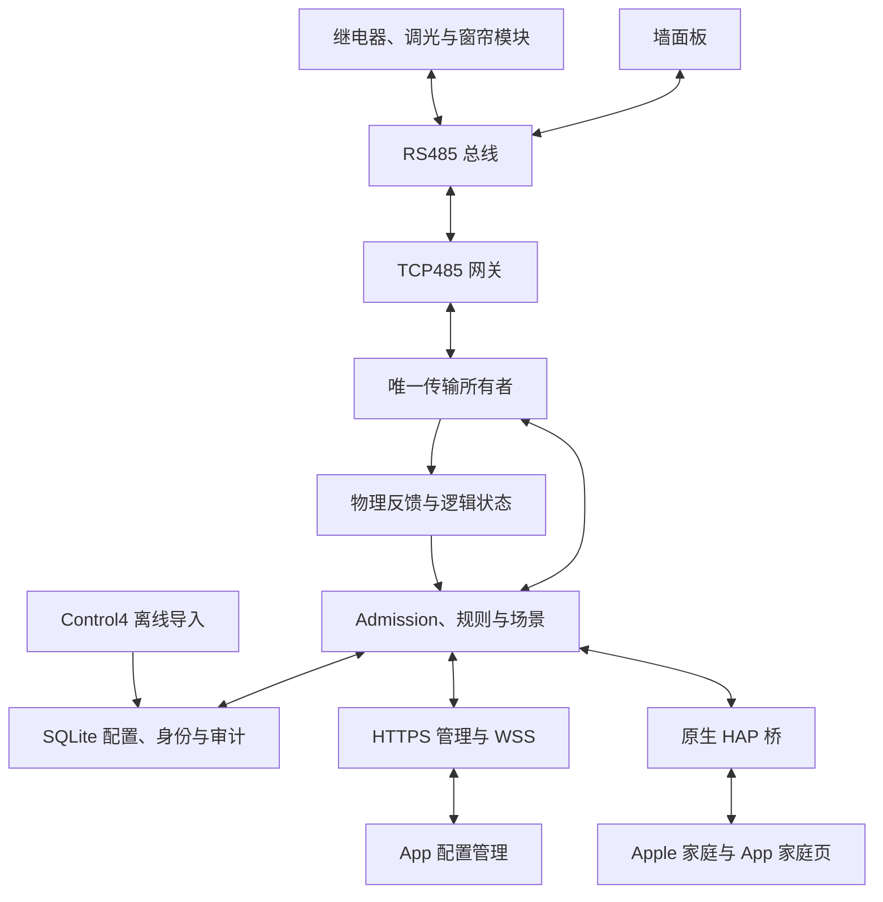

# HomeSense 系统设计

HomeSense 使用 Rust 常驻服务统一控制 HopeBeauty RS485 灯光、窗帘、风机和墙面板，提供原生 HAP 接入、HTTPS 管理接口及 WSS 状态订阅。原生 App 通过 HomeKit 提供家庭日常控制，通过 HTTPS 管理配置。

## 控制与状态架构

每条总线只有一个发送所有者，所有控制来源共用权限检查、准入、队列和审计。TCP 网关允许多连接不代表能够仲裁多个控制者；同一组现场负载与 HAP 身份只由一个主实例运行。

实际反馈、控制目标、已写出记录与估计值分别保存。受理或完整 TCP 写出不能代替设备反馈；未知、过期、断连及代次变化不会被显示为确认关闭。

## 模块与逻辑设备

模块注册表以稳定 `module_id` 保存网关、两位十六进制地址、协议型号和验证信息。逻辑设备通过模块与通道引用物理资源，改名、移房或换址不重建逻辑身份。型号能力、通道范围、重复地址和引用在配置校验时检查。

| 类型 | 功能与边界 |
| --- | --- |
| R818-DIN PRO | 八路继电器开关，逐路状态查询及主动反馈；不支持整模块输出状态查询 |
| AD8-DIN | 八路直接百分比设置及整模块状态读取；亮度值以整数百分比编码 |
| C4-DIN PRO | 已校准的打开、停止、关闭；位置由行程时间估计，不伪造硬件位置反馈 |
| TS6-86 | 六键按下／释放、手动 LED、按型号能力提供的背光、声音及工作模式设置 |
| 逻辑灯 | 组合供电与调光资源，按实际接线处理共享关系及独立开关 |
| 风机 | 继电器开关，HAP 使用风机服务 |

接入的七个 R818 模块启用主动反馈，周期查询作为补偿。参数查询与输出查询分别处理，无地址的单字节参数回复不当作带通道的状态反馈。

详见[模块注册表](rs485-module-registry.md)、[逻辑灯](composed-lights.md)、[共享通道](shared-lights.md)和[窗帘状态](curtain-state.md)。

## 总线发送与查询

连接使用 TCP 长连接，串口为 9600、8N1。发送按线速占用、查询应答与换向间隔协调；同一总线尚有查询等待回复时，不开始另一查询或控制。完整 AD8 查询等待八路回复，R818 查询等待指定一路。

多模块灯光配方按因果阶段和模块推进，等待该模块所需反馈再进入下一模块；失败保留已写出和未确认结果。来源键 LED 可随本次控制即时提示，其他联动 LED 在相关负载证明满足后发送。STOP 和离家有独立优先通道，但不越过正在接收的应答窗口。

启动时同步输出。普通扫描在一轮结束后才安排下一轮，周期在 300～7200 秒间按活动与失败退避；控制关联确认读取单独有界。状态读取和客户端订阅不自行触发全屋扫描。详见[查询与推送](adaptive-query-refresh.md)、[统一按键入口](keypad-actions.md)。

## 场景、规则与面板

配置显式定义场景配方、条件、变量、嵌套调用、延迟和执行预算。来源审核与运行时授权独立，导入成功不会自动启用规则。实体键只执行已审核且启用的映射，按下／释放去重，同一动作不能同时由两个控制器执行。

房间“全部”在范围内有灯亮时关闭，全灭时使用审核后的全开配方；HAP 明确 On／Off 使用对应绝对动作。同一面板有全开和全关键时分别明确执行；只有全开入口时，使用已审核的开启／再次关闭规则，不能按显示名称猜测。

全屋开关以模块命令覆盖登记的全部输出，包含排风扇，不包含窗帘。离家复用全屋关闭，提供有界重试、进度和失败告警；完成绿灯需要本次真实关闭反馈。普通灯光联合请求最多 10 盏，大范围控制使用独立场景入口。

场景选择、负载活动和 LED 提示各有来源；灯光组合有歧义时不猜测最后选择。详见[场景入口](scene-presentations.md)、[目录合并](scene-catalog-consolidation.md)、[全屋控制](hap-room-all-actions.md)。

## 客户端与身份

HAP 桥维护配对、加密会话、稳定 AID／IID 和订阅；配件类型覆盖灯光、风机、场景开关及窗帘。房间归属由 Apple「家庭」管理，原生 App 提供桥匹配、预览和应用流程。

App 的家庭、配置管理和本地调试使用各自的连接与权限。家庭页通过 HomeKit 控制；管理接口使用本机 Keychain 保存的服务令牌。隐藏、常用和房间排序按家庭保存在本机，各台设备独立。详见[App 使用说明](../apps/HomeSense/README.md)。

## 配置、存储与恢复

SQLite 保存活动配置、草稿、变量、请求收据、执行审计和 HAP 身份。草稿保存、预览与发布分开；发布核对预期版本与精确来源权限，进入屏障后取消旧工作，并按规定处理已保留的安全 STOP。

重启将旧非终态命令标记为不确定，不重放设备动作。网关故障期间保留诊断和已建立的管理服务，只有完成新代次同步后才恢复相关控制。详见[来源授权](source-authorization.md)、[生命周期](service-lifecycle.md)、[完整回退](state-upgrade-rollback.md)。

## 测试与部署

完整测试、集成与模拟回归在开发本机执行。部署只上传对应架构的生产 Release ELF 及明确授权的运行资料，目标侧进行兼容性、启动、健康和必要只读验收。

发布先做一致备份，配置独立恢复守护，再短停切换；失败保留证据并整套回退。主机保留当前和最近一个可执行回退版本。部署验收不发送灯光、风机或窗帘控制。

- [实现与开发入口](implementation.md)
- [NanoPi 部署](../deployment/nanopi/README.md)
- [网络架构](network-architecture.md)
- [接管结项与长期观察](control4-takeover-checklist.md)
