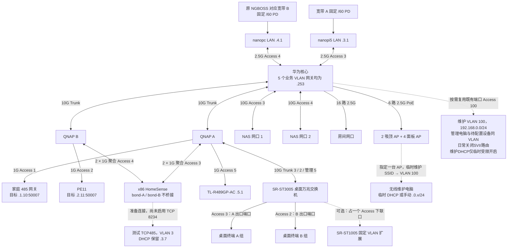

# 知居家庭网络架构设计

版本 1.6，日期 2026 年 10 月 13 日。状态：核心改造仍是待实机验收、尚未下发的目标架构；第 9.4 节另记录现有 VLAN 3 的测试 TCP485 和 DHCP 保留，第 9.5 节记录两台家庭网关的目标迁移。VLAN 100 的现有网关和路由须等现有设备全部迁移并确认无依赖后再关闭，之后保留为二层维护 VLAN。IPv4/IPv6 双流策略同时应用是核心部署前的关键验证项。

逐设备操作见[华为核心、QNAP 与 AC 配置操作手册](network-configuration-runbook.md)，含业务端口标签、管理 VLAN/PVID 分支、VLAN100 维护 SSID、交换机临时 DHCP 示例及恢复步骤；全部为离线草案，尚未下发现网。

采用华为 S5735S-L24PN4XE-A3 作为核心，统一承担业务终端网关、跨 VLAN 路由、默认路由 RA、出口分流和 AP PoE。保留五个业务 VLAN 1、2、3、4、5：1/3 为 A 出口组，2/4 为 B 出口组，5 为 AC/AP 管理；另保留维护 VLAN 100（192.168.0.0/24），用于缺省地址设备的初始化和恢复出厂配置。配对表示共用出口与受控业务访问，各 VLAN 保持独立广播域。NAS 双万兆直连核心；两台 QNAP 保留，六千兆口 x86 通过两组独立聚合接入，作为 HomeSense 服务器。桌面采用希力威视 SR-ST3005 网管万兆交换机，作为二层 VLAN 接入，通过换插 A/B 端口切换出口。

## 1 设备职责与物理拓扑

| 设备 | 职责 |
| --- | --- |
| S5735S-L24PN4XE-A3 | 核心、16 路房间接入、6 台 AP 供电；24 个 2.5G 电口和 4 个业务万兆光口全部使用 |
| nanopi5 | WAN A 边界，LAN 192.168.3.1；拨号、PD、NAT44、WAN 防火墙 |
| nanopc | WAN B 边界，LAN 192.168.4.1；保留原 NGBOSS Wi-Fi 对应出口路径和边界服务 |
| QNAP QSW-M408-4C × 2 | LAN 侧万兆扩展、x86 千兆聚合接入 |
| 六千兆口 x86 | HomeSense 目标服务器；两口接 QNAP A、另外两口接 QNAP B，分别服务 VLAN 3、4 |
| 家庭 485 网关（原 .0.10） | 目标 VLAN 1，192.168.1.10:50007；尚未迁移 |
| PE11（原 .0.11） | 目标 VLAN 2，192.168.2.11:50007；MAC `34:EA:E7:DE:88:77`，尚未迁移 |
| 测试 TCP485 | VLAN 3；MAC `D4:AD:20:C0:17:B5`，DHCP 保留 `192.168.3.7`，TCP Server `8234`；连接草稿尚未启用 |
| NAS | 两个独立 IP 的万兆接口，分别在 VLAN 3、4，不做跨 VLAN 聚合 |
| SR-ST3005 桌面网管万兆交换机 | 10G Trunk 上联 QNAP；终端 Access 口按 VLAN3（A）、VLAN2（B）分组 |
| SR-ST1005 | 保留备用；需要扩展时接 SR-ST3005 的一个 Access 口，下面所有设备共用一个出口组 |
| TL-R489GP-AC | 保留 AC，192.168.5.1；业务采用经验证的本地转发 |
| TL-7AP5100HC-PoE/DC × 2 | 吸顶 AP，由核心供电 |
| TL-7AP5102HI-PoE 薄款 × 4 | 面板 AP，由核心供电 |

核心报价按用户提供的 4468 元记录；新增桌面交换机、光模块和线材另计。核心规格为 400W PoE、1U，机身 442 × 420 × 43.6mm；专用堆叠口不计入业务端口。[华为产品资料](https://e.huawei.com/cn/documents/products/enterprise-network/5e24167930f943f282f9c519eac5b674)



WAN 不进入 LAN Trunk。两台 QNAP 各自单线上联核心；x86 两个聚合接口不桥接、不承担跨 VLAN 转发。保持现有光猫与拨号布线，仅调整规划中的 LAN 链路。

## 2 端口分配

下表是面板位置规划，实际 CLI 接口名以到货设备 `display interface brief` 为准。

| 核心端口 | 对端 | 配置 |
| --- | --- | --- |
| 电口 1–16 | 16 路房间线 | Access 3（A）或 2（B）；专用 A 组 485/管理设备按角色用 1/5，不给房间普通终端开放4 |
| 电口 17–18 | 两台吸顶 AP | PoE；管理 VLAN 5，业务 VLAN 3/2 按 SSID 放行；确有 A 组 IoT SSID 时另加1，不发布 VLAN4 终端 SSID。选电口 17 对应 AP 提供维护 SSID，维护时临时放行 Tagged 100 |
| 电口 19–22 | 四台面板 AP | 同上 |
| 电口 23 | nanopi5 LAN | Access 3 |
| 电口 24 | nanopc LAN | Access 4 |
| 业务光口 1 | QNAP A | 10G Trunk，基线放行 1/2/3/5 |
| 业务光口 2 | QNAP B | 10G Trunk，基线放行 2/4/5；按实际下游增加 3 |
| 业务光口 3 | NAS 网口 1 | 10G Access 3 |
| 业务光口 4 | NAS 网口 2 | 10G Access 4 |

端口预算为 16 + 6 + 2 = 24 个电口，2 + 2 = 4 个光口。两台家庭 485 网关规划接 QNAP 空闲千兆口，不额外占核心端口；如通过房间线接入，使用既有 16 路中的对应端口，不重复计数。本期不留核心扩展口；以后需要时将 NAS 接口下移到 QNAP。维护时临时复用已确认可中断的既有端口，或使用 QNAP 可用端口作为 Access 100，不额外预留核心端口；仅在维护点位确需跨交换机时，两端对应 Trunk 临时放行 Tagged 100，维护结束后撤销该放行并恢复端口原配置。迁移期承载现有 .0.x 设备的链路则保留 VLAN 100，不能提前裁剪。房间线与 AP 上联按独立线缆计数，现场若复用，应按配线架实际减少用口。

| 扩展设备端口（逻辑规划） | 对端及 VLAN |
| --- | --- |
| QNAP A Combo 1 光口 | 核心，Trunk 1/2/3/5 |
| QNAP A Combo 2 电口 | SR-ST3005 端口 1，10G Trunk 3/2/5 |
| QNAP A 千兆口 1 | AC，Access 5 |
| QNAP A 千兆口 2、3 | x86 网口 1、2，独立聚合组 A，Access 3 |
| QNAP A 千兆口 4 | 家庭 485 网关，Access 1（目标 .1.10） |
| QNAP B Combo 1 光口 | 核心，Trunk 2/4/5 |
| QNAP B 千兆口 1、2 | x86 网口 3、4，独立聚合组 B，Access 4 |
| QNAP B 千兆口 3 | PE11，Access 2（目标 .2.11） |
| x86 网口 5、6 | 备用，不接入形成桥接或额外默认路由 |
| QNAP 其他端口 | 保留现有设备；与规划冲突时调整逻辑编号并记录 |

每个 QNAP Combo 的电口与光口共享一个逻辑端口，不能同时计数。聚合在每台 QNAP 上分别建立，不能把跨两台独立交换机的四条线当成同一个 LACP 组。

如果现有 NAS 或边界 LAN 已使用标签，迁移时协调端点与交换机模式；不能一边保留标签、一边误配 Access。AP 管理 PVID 与标签遵循其实际设置。确认旧 AC 的固件兼容这两种 Wi-Fi 7 AP，且本地转发正常。

## 3 五个业务 VLAN、维护 VLAN 100 与迁移映射

| VLAN | IPv4 网段 | 终端默认网关 | 用途 | 默认出口 |
| --- | --- | --- | --- | --- |
| 1 | 192.168.1.0/24 | 192.168.1.253 | A 组 485/IoT，家庭网关 192.168.1.10:50007；与 VLAN 3 配对 | WAN A |
| 2 | 192.168.2.0/24 | 192.168.2.253 | B 组普通终端及 485/IoT，PE11 192.168.2.11:50007；与 VLAN4 基础设施配对 | WAN B |
| 3 | 192.168.3.0/24 | 192.168.3.253 | A 组终端、NAS 口 1、x86 聚合 A、nanopi5 LAN | WAN A |
| 4 | 192.168.4.0/24 | 192.168.4.253 | B 侧基础设施：nanopc LAN、NAS口2；规划的 ngr 聚合B单独登记，不开放普通终端接入 | WAN B |
| 5 | 192.168.5.0/24 | 192.168.5.253 | AC、AP、交换机管理 | WAN B，按需放行 |
| 100 | 192.168.0.0/24 | 迁移期保留现有 192.168.0.253；完成后无网关 | 二层维护：缺省地址设备初始化、恢复出厂配置 | 迁移期沿用现网；完成后无公网出口 |

确认的接入方式：VLAN3 允许 A组普通终端直接接入，并承载 nanopi5 LAN、NAS口1；VLAN2 承载 B组普通终端。VLAN4 除 NAS 接入外不向普通设备开放，保留 nanopc LAN 与此前单独规划的 ngr 服务器接入。VLAN1 保持 IPv4，未启用 IPv6。目标端口及无线入口遵循此规则：房间和桌面 B口为 Access2，B组 SSID 为 VLAN2；核心与边界/NAS、以及此前规划的 ngr 服务链路仍按各自用途保留4。ngr 的 B侧接口属于单独规划的服务器接入，不能据此把4改成普通客户端网段。VLAN2 终端经核心访问 VLAN4 的 NAS/服务器，按必要端口和来源放行；不开放接入口不等于已完成三层 ACL 隔离。VLAN2 的 IPv4 DHCP和 IPv6 RA由核心承担，VLAN4 上的 systemd-networkd/rdhcpd 保留基础设施服务与核心 PD 委派，不向 VLAN2 重复发 DHCPv4。

旧 VLAN 6 终端迁入 3；旧 VLAN 1、2 保留编号，按上述角色重新核对设备，不再整体迁入 4。原 VLAN 100 的 .0.10 迁入 VLAN 1 的 .1.10，.0.11 迁入 VLAN 2 的 .2.11；其他 .0.x 设备先盘点后按角色归入1/2/3，确有基础设施用途才归入4。现有设备全部迁移并确认无依赖后，关闭 VLAN 100 的三层网关和路由、停用其 DHCP 服务/中继及地址池，并停止相关 IPv6 RA（若现网已启用），但保留 VLAN 100 的二层定义用于维护；旧 VLAN 6 的业务 SVI、地址池与路由发布在其迁移完成后撤销。注意 .0.10 的默认公网出口从原 B 调整为 A，需同步其必要外部访问规则。

VLAN 1 用作明确的业务 VLAN，不能让无关接入口因默认 PVID 1 混入；Trunk 只放行必要的带标签 VLAN，未使用端口关闭或移出业务 VLAN。两台网关目标地址须先核查冲突；优先 DHCP 保留，支持情况和 .0.10 的 MAC 尚需核对。使用静态地址时排除出动态池并设置核心 .253 网关。目标 DHCP 分配需有对应 VLAN 的服务接口或经验证的中继，不能只把保留写到现有 VLAN 3 地址池。

配对访问规则：

- VLAN 1/3 共用 WAN A；VLAN 2/4 共用 WAN B。两对通过核心三层路由访问，不桥接、不合并子网。
- HomeSense 优先以 ngr 的 VLAN 3 地址连接 .1.10:50007，以 VLAN 4 地址连接 .2.11:50007；应用不能分别绑定来源时，允许同一个已登记的 ngr 来源访问两台网关，核查实际源地址，不为配对新增实例。
- 安全 ACL 最少放行 ngr → 两个目标 TCP 50007 及返回流量；授权管理终端 → 网关 TCP 80。其余跨组访问按明确需求放行，不因配对就开放整个 VLAN。返回规则按交换机实际能力配置，不假定 ACL 自动进行状态跟踪。
- VLAN2 的普通终端与 PE11 等同网段设备可直接二层通信，跨 VLAN ACL 不负责隔离它们。若有同网段隔离需求，须另行验证端口/AP隔离与允许的管理路径，不能宣称仅靠核心三层 ACL 已完成终端与 IoT 隔离。
- VLAN 5 保留 AC .5.1 和 AP 管理；客户端使用 VLAN3（A）/VLAN2（B）的业务 SSID，本地转发。AP 与 AC 的发现/管理及运维来源按实际协议放行，IPv6 启用时实施对应访问限制。

五个业务 VLAN 的终端 DHCP Router 选项和静态网关统一改为核心 .253，包括 NAS、x86、管理设备；维护 VLAN 100 在迁移完成后不设置网关。**边界路由器自身的互联网默认路由仍指向各自 WAN，不能指回核心。**

地址服务职责确定为：VLAN1/2 的 DHCPv4 由华为核心提供；VLAN3/4 的 DHCPv4 分别保留 nanopi5/nanopc 的 systemd-networkd，DHCPv6、PD 和前缀 RA 由各自 rdhcpd 管理；VLAN5 保留经核对的现有 AP 地址服务；VLAN100 转维护后仅按需开启核心的临时 DHCPv4。每个 VLAN 只能有一个有效 DHCPv4 服务，不新增 dnsmasq。VLAN3/4 的 DHCPv4 Router 需显式指向核心 .253，不能沿用 networkd 缺省的服务端 .1。核对 Option 121 是否包含默认路由；不能只改 Option 3 而被旧 Option 121 覆盖。VLAN 100 的迁移期 DHCP 服务保持至设备迁移完成，转为维护用途后关闭原服务；维护时可按下节临时开启独立 DHCP。历史 AC 主机路由 `.5.1/32 via .3.253` 在统一网关后通常不再需要，先确认其他用途再移除。[原中控设计](design.md)

保留核心 OSPFv2 进程 1、Router ID 10.0.0.6、区域 0.0.0.0；邻居 `.3.1`（RID 10.0.0.3）与 `.4.1`（RID 10.0.0.4）恢复 Full。现有默认路由为 O_ASE 经 `.4.1`，保留作为常规 B 出口。只发布仍使用的网段，核查原 `192.168.0.0/16 → NULL0` 的汇总与重分发用途，不盲目删除或重建。

### 3.1 VLAN 100 的维护模式与关闭条件

**当前 .0.10、.0.11 及其他现有 .0.x 设备尚未全部迁移，不关闭现有 VLAN 100 网关、路由或其所需的 DHCP/访问规则。** 转为维护模式前，须完成设备盘点、目标地址和网关变更、HomeSense 端点及其他依赖更新，并验证新网段的可达性和必要业务。

迁移完成后，关闭/移除 Vlanif100 的三层功能，使 `.0.253` 不再作为网关，撤销 `192.168.0.0/24` 的 OSPF 发布及仅为该网段服务的边界静态回程、PBR、NAT 和访问规则；核查路由表中不再有该网段的专用可达路径。共享的 `192.168.0.0/16 → NULL0` 汇总按原用途单独检查，不随维护转换直接删除。保留 VLAN100 二层定义，日常关闭 SVI 和 DHCP，不启用 IPv6/RA 或互联网出口，不连接业务设备、不向所有 Trunk 放行。

维护 DHCP 改由核心提供：仅维护窗口临时启用 Vlanif100 `192.168.0.254/24` 与专用全局池，结束后关闭。华为接口必须有 IPv4 地址才能选取全局池，因此窗口内会产生 `.0.0/24` 直连路由，不能称为纯二层模式。启用前须验证维护 ACL：允许必要 DHCP，阻止维护与业务网段互访及公网访问；同时限制核心本机管理入口，不把该网段加入 OSPF、边界回程、NAT 或 PBR。ACL 的绑定与 CPU 流量覆盖尚待实机确认，未通过时保持 SVI 关闭、维护电脑手动设地址。

临时池只给已登记维护电脑保留 `.0.200/24`，排除其余可用地址，事先核查 `.0.254`、`.0.200` 和默认设备地址冲突；无线 MAC 使用该 SSID 的实际 MAC。静态绑定不是认证或通用 MAC 白名单；地址限制只是避免其他客户端获租。华为静态绑定租约为无限期，不能声称池的 15 分钟租期能使其自动失效，维护结束必须主动关闭服务并释放客户端地址。不配置 `gateway-list`、`dns-list`、Option121/249，但须抓包验证实际未下发 Router/DNS/静态路由选项；省略配置不等于保证省略选项。若固件仍下发网关，先不启用此模板，采用手动地址同 VLAN 维护。[华为全局池](https://support.huawei.com/enterprise/zh/doc/EDOC1100459025/b4befc01)、[接口绑定](https://support.huawei.com/enterprise/zh/doc/EDOC1100459025/c9c90844)

维护操作流程：

1. 选定可临时使用的端口，记录原 VLAN/PVID；将管理电脑和待配置设备接入同一 VLAN 100，必要时仅延伸对应维护链路。
2. 管理电脑通过临时 DHCP 取得 `192.168.0.x/24` 地址，或手动设置同网段不冲突地址；掩码 `255.255.255.0`，不设置该接口的默认网关。开启 DHCP 前确认没有其他 DHCP 服务，完成后检查实际地址及路由。
3. 默认地址相同的设备一次只连接一台；读取或配置所需业务地址，不把 VLAN 100 与其他业务 VLAN 桥接。
4. 配置完成后把设备移入对应业务 VLAN，验证目标地址；关闭临时 DHCP 和 SVI100、撤销维护链路的临时 VLAN 放行、恢复端口原配置及管理电脑原地址。

维护设备与电脑通过同 VLAN 二层访问，HomeSense 不需要长期连接维护 VLAN。增加其他网段到 `192.168.0.0/24` 的路由并不能独立解决远程维护：核心必须有 VLAN 100 三层接口，设备也必须设置正确回程网关；没有默认网关的出厂设备仍需同 VLAN 访问。因此本期不长期保留跨 VLAN 维护路由。确需远程维护时，可在核对设备回程后临时恢复受限三层接口，仅放行指定管理来源到目标管理端口；不恢复公网出口或 OSPF 发布，维护结束后撤销临时网关、路由及规则。

### 3.2 VLAN 100 无线维护入口

预留一个维护 SSID（示例 `Zhiju-Maintenance`），首期只在电口 17 对应的一台吸顶 AP 上配置，映射 VLAN 100 并使用本地转发。AP 本身管理仍为 VLAN 5，日常业务 SSID 仍为 VLAN3/2，不把整台 AP 移入维护网段。维护 SSID 日常关闭，按需开启，设置独立强密码并限制可使用的维护终端；不以隐藏 SSID 代替访问控制。旧 AC/实际 AP 固件是否支持指定 AP 发布、SSID 到 VLAN 映射及独立关闭，须在部署前验证。

维护时放行该 AP 上联的 Tagged 100；待维护设备或有线维护电脑若在 QNAP，下游接入口用 Access 100，并仅在其到核心的必要链路放行 Tagged 100。管理电脑切到维护 SSID 后，通过第 3.1 节的临时 DHCP 或手动地址进入 .0.0/24，即可同 VLAN 访问默认地址设备。临时 DHCP 位于核心，须确保 Tagged100 到达该 AP 和目标设备；AC 不额外启动 DHCP 服务。

该 SSID 的客户端隔离/访问规则不能阻断维护电脑到待维护设备的必要管理流量。切换后验证实际地址、无互联网默认路由以及到目标管理页的可达性；没有互联网是维护网段的预期状态，若电脑自动切回其他 Wi-Fi 或手机优先使用移动数据，应明确保持维护连接。结束后关闭维护 SSID 和临时 DHCP、撤销临时 VLAN 放行，恢复电脑和端口原配置。无线维护入口不恢复常驻 VLAN100 网关或公网出口；核心临时 SVI 仅用于上述经隔离验证的 DHCP 窗口。

## 4 IPv4 出口策略模板

处理顺序：访问限制 → 内网目的按路由表 → 可选单机例外 → VLAN 1/3 源走 A → VLAN 2/4/5 源走 B。内网豁免不是安全放行规则；正式配置须合并已有隔离策略。VPN、远端内网若存在，也要补入目的豁免与正常路由。

以下 ACL 编号和策略名需先检查冲突。语法基于华为 V600R024C10 文档；策略定义与实际绑定分开，绑定限制见第 6 节。[重定向配置](https://support.huawei.com/enterprise/zh/doc/EDOC1100459022/93a2f4f2)

```text
acl 3000
 rule 5 permit ip destination 192.168.1.0 0.0.0.255
 rule 10 permit ip destination 192.168.2.0 0.0.0.255
 rule 15 permit ip destination 192.168.3.0 0.0.0.255
 rule 20 permit ip destination 192.168.4.0 0.0.0.255
 rule 25 permit ip destination 192.168.5.0 0.0.0.255
 quit
acl 3001
 rule 5 permit ip source 192.168.1.0 0.0.0.255
 rule 10 permit ip source 192.168.3.0 0.0.0.255
 quit
acl 3002
 rule 5 permit ip source 192.168.2.0 0.0.0.255
 rule 10 permit ip source 192.168.4.0 0.0.0.255
 rule 15 permit ip source 192.168.5.0 0.0.0.255
 quit
traffic classifier V4_LOCAL type or
 if-match acl 3000
 quit
traffic classifier V4_A type or
 if-match acl 3001
 quit
traffic classifier V4_B type or
 if-match acl 3002
 quit
traffic behavior V4_ROUTE
 permit
 quit
traffic behavior V4_TO_A
 redirect nexthop 192.168.3.1 fail-action discard
 quit
traffic behavior V4_TO_B
 redirect nexthop 192.168.4.1 fail-action discard
 quit
traffic policy V4_EGRESS
 classifier V4_LOCAL behavior V4_ROUTE precedence 10
 classifier V4_A behavior V4_TO_A precedence 30
 classifier V4_B behavior V4_TO_B precedence 40
 quit
```

可选 IPv4 单机例外：将保留地址 `192.168.3.50` 的桌面设备改走 B，保持其 IPv4 地址不变。该地址仅为示例，使用前确认未占用。

```text
acl 3013
 rule 5 permit ip source 192.168.3.50 0
 quit
traffic classifier V4_DESK_B type or
 if-match acl 3013
 quit
traffic policy V4_EGRESS
 classifier V4_DESK_B behavior V4_TO_B precedence 20
 quit
```

切回 A 时撤销该主机的匹配规则，保留其他主机例外。此方案**只切 IPv4**，IPv6 仍按原源前缀走 A；完整双栈切换使用第 8 节换 VLAN 的方案。

## 5 IPv6 前缀、RA 与分流

`2001:db8::/32` 全部是文档地址，不可用于实际公网。A 示例 PD 为 `2001:db8:1000:1000::/60`，B 为 `2001:db8:2000:2000::/60`。一个 /60 包含 16 个 /64；按实际前缀计算子网偏移，不能任意拼接字符串。

| VLAN | 发布的唯一 /64 | 核心地址 | 边界地址 |
| --- | --- | --- | --- |
| 1 | 保持 IPv4，不启用 IPv6/RA/PD绑定 | 无 | 无 |
| 2 | 2001:db8:2000:2002::/64（B 偏移2示例，实际取 ng4prefix 租约） | 2001:db8:2000:2002::253 | 无 |
| 3 | 2001:db8:1000:1003::/64（A 偏移 3） | 2001:db8:1000:1003::253 | nanopi5：2001:db8:1000:1003::1 |
| 4 | 2001:db8:2000:2004::/64（B 偏移 4） | 2001:db8:2000:2004::253 | nanopc：2001:db8:2000:2004::1 |
| 5 | 首期 IPv4 管理，不发布 RA | 无 | 无 |
| 100 | 维护模式不启用 IPv6、不发布 RA | 无 | 无 |

上表为固定地址的演算示例，不能认定为 DHCPv6-PD 实际分配结果。目标保留自动委派：两边 WAN DHCPv6 客户端各获取 /60，rdhcpd 使用各自池。A侧终端直接接 VLAN3，使用该 LAN 的 /64，不需要先向核心委派再用于 VLAN1；B侧核心在 Vlanif4 向 nanopc 请求独立 /64，供 Vlanif2 使用。VLAN1 本次不启用 IPv6，也不新增 ng3prefix 绑定。旧核心已有 ng3prefix 请求的用途见第5.1节，需核查其他接口引用后再决定是否撤销，本次不改现网。VLAN3/4 自己的 /64 必须从池中保留，不向核心重复委派；收到的 PD 不作为上行 VLAN3/4 的链路前缀。一个 /64 只能用于一个下游二层网段。

**目标 V600 /64 自动绑定存在官方指南限制，尚不能认定可上线；旧核心已获租且下游 /64 地址生成已生效的实证见第5.1节。** V600R024C10 的 DHCPv6 型号表包含 S5735S-L24PN4XE-A3，并有 PD 客户端配置；但指南要求下游接口绑定长度大于获得的 PD 长度，因而按该文档 `/64 PD → 下游 /64` 不成立。需华为提供到货固件支持相等长度绑定的依据并隔离验证，才能实施用户指定的 /64 方案。替代候选为 B侧委派 /63、VLAN2 取一个 /64，尚未采纳；不得改为给终端发布 /65。更改 rdhcpd `--slice-length 63` 也不能直接上线：当前源码将该长度用于 LAN 保留前缀、RA 和 IA_NA，需先把 LAN /64 与 PD 切片长度解耦并迁移旧租约。[型号范围](https://support.huawei.com/enterprise/zh/doc/EDOC1100459025/26526a63)、[PD 客户端与绑定限制](https://support.huawei.com/enterprise/zh/doc/EDOC1100459025/afdcdd55)

本地 `rproxy/rdhcpd` 源码核查（2026-10-13）：支持 IA_PD、`--pool-prefix`、`--slice-length`（默认64），为委派前缀添加经请求客户端地址的回程路由。它是 PD 服务端，不直接向运营商申请 /60；自动池发现读取内核 DHCP unreachable 路由，当前仅在启动时进行。LAN 已用前缀会从池中排除。PD 租约按 DUID 存储，两条线路须由独立实例、各自池和租约文件管理；不能让同一个实例按两个 IAID 当成两条线路的独立委派。核查实际上游剩余有效期、前缀变化与服务重启/续租衔接，不能把本地常量租期当成运营商授权期。

### 5.1 现网 PD 核查记录（2026-10-13，未改配置）

边界只读核查确认：nanopi5、nanopc 的 rdhcpd 均运行于 br-lan，`--slice-length 64`，内核各有 DHCP 类型的 /60 池路由。两边租约中存在同一核心候选 DUID，对应链路本地下一跳的邻居 MAC 一致。实际公网前缀不写入模板，仍使用文档地址示例。

用户随后提供核心输出：Vlanif4 为 PD 客户端，前缀名 `ng4prefix`，实际获得 /64；Vlanif3 为 PD 客户端，前缀名 `ng3prefix`，其前缀字段尚未提供。两接口快照均为 REBIND，Vlanif4 的 T1=1800、T2=2700、首选期3600、有效期7200秒。这确认上行 PD 获租能力；下游接口核查已证实 VLAN2 的 /64 地址生成，VLAN1 未启用 IPv6，详见下段。现有核心此前报告为 S5720S V200R019，不以它的行为自动证明目标 S5735S-L3 V600 的行为，也不以新版指南否定尚未读到的旧机实际配置。

用户提供的接口配置进一步确认：Vlanif3 使用 `dhcpv6 client pd ng3prefix`，上行地址通过 `ipv6 address auto global` 自动获取；Vlanif2 已配置 `ipv6 address ng4prefix ::1/64`，并开启 RA、M/O 标志、OSPFv3 和接口 DHCPv4。用户随后提供 `display ipv6 interface Vlanif2`：接口和协议均 UP，全球地址为 B 侧实际委派 /64 加 ::1，RA 有效期1800秒、M/O有状态模式。这证明旧核心 /64 PD→下游 /64 地址生成已生效；实际 RA 的 PIO、终端获址与续租稳定性仍待包级确认。Vlanif1 完整配置随后已提供：只有 IPv4 地址和接口 DHCPv4，未启用 IPv6、未绑定 ng3prefix；其 IPv6 查询返回 `No IPv6 address exist on the specified interface`。用户明确确认 VLAN1 当前未配置 IPv6；这是现状，不是故障，也不要求本次补配。未来确有 IPv6 终端需求时，才考虑通过 VLAN3 的 ng3prefix 为 VLAN1 启用 IPv6。ng3prefix 是否用于其他接口仍待核查。现有 Vlanif2 IPv6 地址后缀为 ::1，不要求与 IPv4 网关 .253 数字一致。

Vlanif2 的 `dhcp select interface` 是 DHCPv4；M/O 标志不自动创建 DHCPv6 服务或中继，该片段未显示这些功能，须核对有状态 DHCPv6 是否实际可达。Vlanif3 没有开启核心 RA 的配置，当前上行自动地址与目标“核心统一默认路由 RA”分工不同，应分别记录现状与目标。

Vlanif4 的完整配置已确认：`dhcpv6 client pd ng4prefix`、`ipv6 address auto global default`、OSPFv3进程1、OSPFv2 cost10，未显示核心 RA 开启命令。因配置含 `auto global default`，切换目标架构时需核查其从边界 RA 自动学习默认路由的行为；不能把现有核心上行学习默认路由与目标只由核心给终端通告默认路由混为同一配置。

本轮本地源码核查发现 `rdhcpd/src/dhcp.rs` 未定义 Renew/Rebind 消息，`src/main.rs` 的处理分支仅处理 Solicit、Request、InformationRequest，其余忽略。这是当前 REBIND 的候选原因，尚需运行二进制对应源码或抓包确认；不能认定续租已通过。已获租前缀有效期尚余不表示长期稳定，到期会面临失效风险。Vlanif1/2 配置及 IPv6 地址状态已核对；继续核查 ng3prefix 的实际绑定接口、Vlanif3 完整前缀和路由，再决定目标 PD 绑定方式；不重启或强制续租掩盖问题。

### 5.2 RA 职责与候选模板

| VLAN | 前缀 / 地址服务 | 默认路由通告 |
| --- | --- | --- |
| 1 | 保持 IPv4，不启用 IPv6/PD绑定 | 无 |
| 2 | 核心绑定 ng4prefix 并发布下游 /64 PIO；新核心绑定验收前不启用 | 核心 RA，RouterLifetime > 0 |
| 3/4 | 各自 rdhcpd 管理 DHCPv6、发布本 LAN /64 PIO | 核心单独发不含 PIO 的 RA；rdhcpd RouterLifetime 必须为0 |
| 5/100 | 首期不启用 IPv6/RA | 无 |

终端的 IPv6 默认网关是核心链路本地地址。RA 发布者可以有两个，但只有核心通告默认路由；两者 M/O 标志和 DNS 信息须一致。保留边界 WAN PD 客户端，不让边界自身默认路由指回核心，也不让核心从边界 RA 学到绕过出口策略的默认路由。

**rdhcpd 的前缀 RA 模式尚缺能力：** 当前本地 `rdhcpd/src/ra.rs` 将 RouterLifetime 固定为1800，CLI 没有设置0的参数。须先实现并验证该能力，再采用双 RA 分工；不能靠提高核心 RA 优先级代替。本文不改动 rproxy 或部署二进制，也不虚构 RouterLifetime 配置开关。

以下只展示核心 Vlanif3 的默认路由 RA 候选；先清除该接口已有的显式 PIO，否则 `default no-advertise` 不会隐藏它们。所有 RA 启用命令在能力和包级验证完成后才执行：

```text
interface Vlanif3
 ipv6 enable
 ipv6 address 2001:db8:1000:1003::253 64
 ipv6 nd ra prefix default no-advertise
 ipv6 nd ra max-interval 200
 ipv6 nd ra min-interval 60
 ipv6 nd ra router-lifetime 600
 ipv6 nd ra halt disable
 quit
```

Vlanif4 使用其 LAN /64 和 `::253`，同样不包含 PIO。rdhcpd 发布各自 VLAN3/4 的 /64；核心 Vlanif2 则在 PD 绑定验收通过后自动形成接口地址和对应 PIO，不把表中示例地址、静态 PIO 与动态绑定并存。此处不提供受 /64 限制阻断的可执行 PD 绑定脚本。

SLAAC 模式两台 RA 发布者均保持 M/O 关闭；rdhcpd 当前有 `--disable-ra-managed`、`--disable-ra-other-config`，需要 DHCPv6 有状态地址时另行统一标志。RDNSS 指向实际 DNS 服务，rdhcpd 默认使用自己的链路本地地址，需核实该地址能解析。PIO 首选/有效期不得超过上游授权剩余期；PD 更新后的旧地址弃用、租约释放与默认路由撤回须抓包验证。[RA 属性](https://support.huawei.com/enterprise/zh/doc/EDOC1100459025/73a81c9a)、[启用 RA](https://support.huawei.com/enterprise/zh/doc/EDOC1100459025/e317010b)

### 5.3 IPv6 策略定义

以下是表中固定示例的离线策略；自动 PD 获租、续租或重分配后必须同步实际 Vlanif2 的 /64、目的豁免和跨线路回程，再放行流量。源出口匹配固定 /60 已覆盖其所有子网，但不会自动更新目的 ACL、下一跳和安全规则。只把实际启用的内网 /64 放入目的豁免；VLAN1 保持 IPv4，不加入 IPv6 ACL/回程；VLAN2 在新核心 PD 验收通过前不启用目标 RA，也不加入其尚未生效的 /64。不要用 ACL deny 表达“跳过 PBR”，这里使用正常转发行为。[ACL6](https://support.huawei.com/enterprise/zh/doc/EDOC1100459025/f8718c03)、[MQC permit/deny](https://support.huawei.com/enterprise/zh/doc/EDOC1100459022/64159c7c)

```text
acl ipv6 3100
 rule 10 permit ipv6 destination 2001:db8:2000:2002:: 64
 rule 15 permit ipv6 destination 2001:db8:1000:1003:: 64
 rule 20 permit ipv6 destination 2001:db8:2000:2004:: 64
 quit
acl ipv6 3101
 rule 5 permit ipv6 source 2001:db8:1000:1000:: 60
 quit
acl ipv6 3102
 rule 5 permit ipv6 source 2001:db8:2000:2000:: 60
 quit
traffic classifier V6_LOCAL type or
 if-match ipv6 acl 3100
 quit
traffic classifier V6_A type or
 if-match ipv6 acl 3101
 quit
traffic classifier V6_B type or
 if-match ipv6 acl 3102
 quit
traffic behavior V6_ROUTE
 permit
 quit
traffic behavior V6_TO_A
 redirect ipv6 nexthop 2001:db8:1000:1003::1 fail-action discard
 quit
traffic behavior V6_TO_B
 redirect ipv6 nexthop 2001:db8:2000:2004::1 fail-action discard
 quit
traffic policy V6_EGRESS
 classifier V6_LOCAL behavior V6_ROUTE precedence 10
 classifier V6_A behavior V6_TO_A precedence 30
 classifier V6_B behavior V6_TO_B precedence 40
 quit
ipv6 route-static :: 0 2001:db8:2000:2004::1
```

核心本机流量不等同于终端入方向 PBR，本机公网访问使用 B 的源地址与默认出口。用终端验证分流，不能仅凭核心 ping 下结论。

## 6 策略绑定与硬件转发验证门槛

官方要求 IPv4、IPv6 分类分别配置流策略。该型号所属 S5735S-L3 的应用层级存在端口 > VLAN > VLANIF > 全局的优先关系；不能假定放到不同层级就能叠加生效。当前查阅的资料未明确确认该型号同一 Vlanif 入方向同时承载两套独立双栈策略的具体方式。[流分类](https://support.huawei.com/enterprise/zh/doc/EDOC1100459022/7b8eba15)、[策略应用](https://support.huawei.com/enterprise/zh/doc/EDOC1100459022/53fc6a8)、[型号限制](https://support.huawei.com/enterprise/zh/doc/EDOC1100459022/7b4f6521)

下面是**仅供实验验证的候选绑定**，不是已确认适用于该型号的生产脚本：

```text
interface Vlanif3
 traffic-policy V4_EGRESS inbound
 traffic-policy V6_EGRESS inbound
 quit
```

先要求卖家或华为支持提供该型号、实际固件版本下双栈同时生效的配置与测试证据，再在隔离环境验证：第二条不替换第一条、两套策略均成功下发、IPv4 和 IPv6 分别命中且出口正确。验证通过后，以该固件支持的方式覆盖 VLAN3、4及启用 IPv6 的 VLAN2；VLAN1、管理 VLAN5 仅需 IPv4。

如果该绑定不支持，应取得官方支持的替代应用方式并复测；不能直接上线，也不能把“能输入命令”当作成功。本设计暂不以未经验证的混合 IPv4/IPv6 单策略替代。

安全 ACL 与 PBR 的组合、URPF 限制、TCAM 资源、内网豁免停止后续重定向的效果均需验证。检查命令按实际版本补全参数：

```text
display version
display traffic-policy applied-record
display system tcam fail-record
display system tcam service traffic-policy
display traffic-policy statistics
```

只有下发成功并经过实际跨 VLAN/PBR 吞吐和 CPU 测试，才能认定本组配置满足硬件转发要求；本文件不承诺所有组合线速。

## 7 边界回程、NAT 与链路故障

两台边界保留各自 WAN 默认路由。IPv4 通过原 OSPF 学习其他四个内网网段，或配置经各自核心 `.253` 的具体静态回程，不能同时遗漏回程又只加默认路由。

| 边界 | IPv4 非直连内网回程经核心 | NAT44 来源 |
| --- | --- | --- |
| nanopi5 A | 192.168.1.0/24、192.168.2.0/24、192.168.4.0/24、192.168.5.0/24 → 192.168.3.253 | 192.168.1.0/24、192.168.3.0/24 |
| nanopc B | 192.168.1.0/24、192.168.2.0/24、192.168.3.0/24、192.168.5.0/24 → 192.168.4.253 | 192.168.2.0/24、192.168.4.0/24、192.168.5.0/24；启用单机例外时加相应来源 |

边界转发规则要允许核心下游子网，不能只允许边界自身的直连 LAN。IPv6 使用运营商授权前缀，无 NAT66：

| 边界 | IPv6 静态回程（仅启用的网段） |
| --- | --- |
| A | VLAN 2：2001:db8:2000:2002::/64、VLAN 4：2001:db8:2000:2004::/64 → 2001:db8:1000:1003::253 |
| B | VLAN 2：2001:db8:2000:2002::/64、VLAN 3：2001:db8:1000:1003::/64 → 2001:db8:2000:2004::253 |

上表为固定示例。自动 PD 成功时，B 到 Vlanif2 的回程应由 nanopc 的 rdhcpd 创建，核查实际下一跳，不再重复覆盖为表中静态地址；跨线路回程仍需租约同步或经验证的 OSPFv3。本机直连前缀无需再加静态。两边都维护内网回程，保证边界 DNS 等本机服务能回复跨 VLAN 客户端。不能把未分配的整个 /60 指回核心形成默认路由环路。需要动态回程时改用经验证的 OSPFv3，只发布实际 /64；它不替代源前缀分流。[OSPFv3 型号范围](https://support.huawei.com/enterprise/zh/doc/EDOC1100459029/40985183)

本五个业务 VLAN 方案仍把边界和 VLAN3终端、VLAN4的 NAS/服务器放在同一网段，因此回包可能由边界直接二层送到终端，不经过核心。这是已知的不对称路径，WAN 状态防火墙保留在边界。检查并抑制核心发出的 ICMP/ICMPv6 Redirect，避免终端学到绕过核心的互联网下一跳；对应命令依实际固件确认。维护 VLAN 100 在迁移完成后不参与边界回程、NAT 或出口分流。

`fail-action discard` 只在重定向下一跳不可用时控制回落；边界 LAN 仍在线而 WAN 断开时，它不是完整线路探测。A 的 IPv6 源前缀不能直接改走 B。固定出口 VLAN 本期没有自动双线故障切换；桌面可换到另一出口的端口重新取地址。连接需要重建。

更换 PD 时同步修改边界地址、核心 SVI/RA、源前缀 ACL、目的豁免、下一跳、回程、防火墙和 DNS。旧前缀首选期降为 0 仅在正确的过渡授权下使用，不能继续通告已被运营商撤销的前缀。

## 8 桌面设备完整切换 WAN

桌面型号采用 **希力威视 SR-ST3005**，经 QNAP A 的 Combo 2 万兆电口上联，不新增核心端口。官网列出 5 个 10G RJ45 口、1 个 Console 口，以及 Web、802.1Q VLAN、LACP；本方案只用二层交换和 VLAN，不启用业务 VLAN 间路由、DHCP 或 RA，终端网关继续由核心承担。[SR-ST3005 官方产品页](https://cloud.sirivision.com/official-website/products/7/67)

官网当前没有该型号的下载手册，尚未逐项核实实际固件的 Tagged/Untagged、PVID 与独立管理 VLAN 页面。采购前请卖家提供这些配置页面及保存重启后的保留结果；不能只凭“三层网管”字样认定全部配置细节已验证。

| SR-ST3005 端口（规划编号） | VLAN 配置 | 用法 |
| --- | --- | --- |
| 1 | Trunk，Tagged 3、2；独立管理支持时加5，不承载普通终端 VLAN4 | 10G 电口接 QNAP A Combo 2，两端标签一致 |
| 2、3 | Untagged 3，PVID 3，移除无关 VLAN 成员 | A 出口设备；也可预留其中一口供换插 |
| 4、5 | Untagged 2，PVID 2，移除无关 VLAN 成员 | B 出口设备；也可预留其中一口供换插 |

5 个业务口中 1 个用于上联，剩余 4 个用于终端。Console 不计为网络口。保留空闲的另一出口端口才能方便换插；也可按实际设备数量调整 A/B 口数。交换机支持独立管理 VLAN 时用 5，否则用受控业务 VLAN 管理并限制来源。

旧 SR-ST1005 首期可不连接，作为备用；需要扩展时，接到端口 2–5 中任意一个，替代该口直连终端的位置。它下面所有设备继承该端口的单一 VLAN，不能各自通过换 SR-ST1005 的端口切换出口。桌面所有跨上联流量共享这条 10G 链路；本方案不使用 LACP 占用额外端口。

切换操作：将电脑网线从 A 口换到 B 口，触发链路重连与 DHCP 更新，等待新 RA/SLAAC；确认旧 IPv6 地址和默认路由不再被选用，必要时重置该网卡网络连接。此时 IPv4 从 `.3.x/.3.253` 变为 `.2.x/.2.253`，IPv6 从 A 前缀变为 B 前缀。分别检查 IPv4、IPv6 公网出口，应用重新连接；不承诺现有会话无感延续。

也可在 Web 管理中改同一个终端端口的 Untagged 成员和 PVID，再触发终端网络更新；仅改 PVID 不足以保证收发一致。独立端口切换只影响该端口设备，改 SR 上联的 VLAN 则影响 SR 下所有设备。不要把 A、B 两个 Access 口同时接入 SR-ST1005，会混接两个广播域。

## 9 x86 HomeSense 服务器

### 9.1 接入与地址

沿用现有两组双千兆聚合：组 A 连接 QNAP A 并承载 VLAN 3，组 B 连接 QNAP B 并承载 VLAN 4。具体聚合模式尚未提供，先导出两端配置：若是 LACP，服务器和各 QNAP 对应组均保持 802.3ad；若是静态聚合或主备，按现有模式核对，不能单方面切换。

服务器上 IP 配在聚合逻辑接口，成员物理接口不另配业务 IP。每组两条千兆链路提供链路冗余；LACP 多流合计带宽可接近 2Gbps，单流通常仍限一条千兆链路，具体取决于哈希。两组不构成跨交换机故障接管。[Linux bonding 官方说明](https://docs.kernel.org/networking/bonding.html)

| 接口逻辑名（示例） | VLAN | IPv4 示例 | 用途 |
| --- | --- | --- | --- |
| bondA | 3 | 192.168.3.20/24 | A 组客户端服务 |
| bondB | 4 | 192.168.4.20/24 | B 侧服务器服务地址、默认主动访问出口；客户端在2，经核心访问 |

`.20` 仅为配置示例，优先保留现有静态地址并排除 DHCP 冲突。HomeSense 不需要两张网卡才能跨 VLAN 服务，但此方案复用现有接线与两网段服务方式。CPU、内存、磁盘未提供，网络接入可行不代表已完成运行容量与可靠性验收。

### 9.2 服务器回程策略

主路由表只保留一个普通默认路由，建议经 bondB 到 `192.168.4.253`。未指定来源的主动连接、更新和外部访问默认使用 B；到两台 485 网关的内网连接经核心路由，不按公网出口绕行。需要保持配对来源时，由应用分别绑定 A/B 服务地址，或为 .1.10/.2.11 设置明确的目的路由和首选源地址。若应用绑定 A 地址，则用源地址策略表经核心 `.3.253`。不要在主表放两条无区分的同优先级默认路由。

以下为 Linux 临时路由示例，假设接口名、地址均已按上表配置，表号 103/104 和规则优先级尚未占用。它不负责创建聚合，也不是可直接导入未知系统的持久配置：

```sh
ip route replace default via 192.168.4.253 dev bondB
ip route replace table 103 192.168.3.0/24 dev bondA src 192.168.3.20
ip route replace table 103 192.168.4.0/24 dev bondB src 192.168.4.20
ip route replace table 103 default via 192.168.3.253 dev bondA
ip route replace table 104 192.168.3.0/24 dev bondA src 192.168.3.20
ip route replace table 104 192.168.4.0/24 dev bondB src 192.168.4.20
ip route replace table 104 default via 192.168.4.253 dev bondB
ip rule add priority 1030 from 192.168.3.20/32 table 103
ip rule add priority 1040 from 192.168.4.20/32 table 104
```

两张表都保留两个直连网段，避免本地请求绕行网关；其他内网目的到核心后命中内网豁免，外网按源地址选择出口。按实际服务源地址验证 `ip route get <客户端地址> from <服务地址>`；新增 VPN、容器网段也要协调其路由。重复执行 `ip rule add` 前检查旧规则，最终持久化到实际网络管理器。

服务器首期可只承载 IPv4 服务。若启用两组 IPv6 地址，应为每个服务源地址设置对应源路由表：包含两条直连 /64，默认分别经 A/B 网段的核心 ::253；同时控制自动 RA 默认路由，不能仅依赖两个接口收到 RA 后的默认优先级。动态/隐私地址启用时同步规则或对实际接口前缀制定规则。NAS 双接口也应检查同类回程和默认路由问题。

服务器不桥接 VLAN 3/4，不启用不需要的 IPv4/IPv6 转发、NAT、DHCP 或 RA。容器/虚拟化平台可能自动开启转发，需检查实际配置。若严格 IPv4 rp_filter 与合法多宿主路径冲突，可在相关接口评估 loose 模式并保留来源过滤，不能一律关闭检查。[Linux IP sysctl](https://www.kernel.org/doc/html/latest/networking/ip-sysctl.html)

### 9.3 服务监听、发现与迁移

优先运行一个 HomeSense 运行实例，保留一套设备状态与配对身份；不要因两个网段启动两个同时控制相同硬件的独立实例。实际程序是否支持两个监听地址、双接口 mDNS 发布须从所部署版本验证，不能默认绑定 `0.0.0.0` 就解决所有问题。

如果当前版本仅稳定支持单 LAN 监听，可先将服务绑定 VLAN 4 地址，让 VLAN3及VLAN2客户端经核心访问，并在必要范围提供受控 mDNS 转发。即使服务器在3/4双接口发布，仍须解决客户端 VLAN2 的跨网段发现，不能凭4上的发布认定2可发现。服务器双网口不是跨 VLAN mDNS 反射器。

[nanopc 部署记录](../deployment/nanopc/README.md)曾记录 mDNS 使用默认组播接口及枚举多个地址的问题。它是历史证据，不代表当前代码一定仍有问题。需在实际客户端 VLAN3、VLAN2 验证发现记录、可达的 SRV/A/AAAA、配对与经批准的控制；VLAN4检查 NAS/服务器服务和回程，不将其当成普通终端验收入口。过去3/4模拟发现结果不能自动等同于新目标3/2验收。mDNS 属于链路本地发现，跨 VLAN 需明确受控转发方案，普通单播路由不能自动转发其组播。[mDNS 链路范围](https://www.rfc-editor.org/rfc/rfc6762.html)

从 nanopc 迁移时备份配置、身份和配对数据、自动化状态及运行目录；构建适合 x86 的二进制。停止旧实例后启用新实例，避免同一身份双活和重复控制。保留 nanopc 的 PPPoE、rproxy、rdhcpd、OSPF 等边界服务。新旧地址变化同步更新访问规则、发现信息和监控。

迁移前保留 HomeSense 到 `192.168.0.10:50007` 的现网连接；目标改为 `192.168.1.10:50007`，新增 PE11 的目标 `192.168.2.11:50007`。两者回复各自核心 `.1.253`/`.2.253`，按第 3 节放行 ngr 来源。迁移时同步连接配置、地址保留和监控，避免只改网络地址却留下旧端点。PE11 的总线模块尚未登记，不能直接复制 .0.10 的设备映射或启用真实控制。HAP 服务端口以运行实例为准，历史 51826/51827 不当作永久常量。[中控设计](design.md)

### 9.4 VLAN 3 测试 TCP485 与连接草稿

这台网关用于测试，独立于家庭总线的 HopeBeauty（现网 `192.168.0.10:50007`，目标 `192.168.1.10:50007`）。它接入现有 VLAN 3，实际交换机／面板端口编号待登记，不据此调整第 2 节的核心端口预算。

| 项目 | 当前记录 |
| --- | --- |
| 设备 MAC | `D4:AD:20:C0:17:B5` |
| 设备地址方式 | DHCP；固定地址由服务器保留，不再在设备内写静态地址 |
| DHCP 服务器 | nanopi5 `192.168.3.1`，systemd-networkd，接口 `br-lan` |
| 固定租约 | `192.168.3.7/24`；动态池仍为 `192.168.3.100–249` |
| 当前 DHCP 网关／DNS | `192.168.3.1`；这是现网参数，区别于目标核心网关 `.3.253` |
| HomeSense TCP 端点 | `192.168.3.7:8234`，TCP Server |
| 管理页面 | `http://192.168.3.7/`，端口 80；用户已更换管理密码，凭据不写入连接配置 |
| 最近确认的串口参数 | 9600 baud、8 数据位、无校验、1 停止位；本轮不调整串口或工作模式 |
| 本轮范围 | 已核对 DHCP 固定租约、MAC 和管理页可达性；HomeSense 透传连接尚未启用，未发送 RS485 控制 |

服务器保留文件为 `/etc/systemd/network/25-br-lan.network.d/70-homesense-test485.conf`：

```ini
[DHCPServerStaticLease]
MACAddress=d4:ad:20:c0:17:b5
Address=192.168.3.7
```

此保留按 MAC 分配，语法见 [systemd 官方配置说明](https://github.com/systemd/systemd/blob/v257/man/systemd.network.xml)。主 DHCP 配置、动态池及现有 Option 121 保持；切换目标核心网关时，再协调 DHCP Router、Option 121 和该保留记录的迁移，TCP 端点继续保持 `.3.7:8234`。

本轮设备切换 DHCP 后曾获得 `.3.203`，旧动态租约阻塞了保留地址的 OFFER；仅移除该 MAC 的旧租约后，实际完成 `.3.7` 的 OFFER／REQUEST／ACK，ARP 的 MAC 一致，管理页返回登录认证要求。其他 17 个客户端的租约 IP 保留，现网 IPv4 路由与 IPv6 地址复核正常。后续调整保留地址时先核对该设备旧租约，不清空整个地址池。

HomeSense 的本地准备文件为设备／连接草稿 `config/test/tcp485-vlan3.devices.json` 和空自动化草稿 `config/test/tcp485-vlan3.automation.json`；两份草稿尚未纳入仓库发布，下列检查需在持有草稿的工作区执行。设备草稿使用 schema 2，仅登记 `test485-vlan3` 网关与端点，模块和设备列表为空；没有复制家庭模块、场景、配对或控制规则。确认测试模块的型号、总线地址与稳定模块 ID 后，再单独登记和审核，不猜测模块协议或改变串口设置。

当前只执行离线解析检查，不运行连接服务：

```sh
homesensed check-config config/test/tcp485-vlan3.devices.json
homesensed check-automation config/test/tcp485-vlan3.devices.json config/test/tcp485-vlan3.automation.json
```

这些检查不会打开网关连接。连接草稿没有启用的设备绑定，不能作为已可控制的运行配置；实际测试连接与模块查询另行安排，不接管家庭设备。

### 9.5 家庭网关与 PE11 的目标迁移记录

| 项目 | 家庭网关 | PE11 |
| --- | --- | --- |
| 已知现网端点 | 192.168.0.10:50007 | 192.168.0.11:50007 |
| 目标 VLAN / 出口组 | VLAN 1 / A（配对 VLAN 3） | VLAN 2 / B（配对 VLAN 4） |
| 目标端点 | 192.168.1.10:50007 | 192.168.2.11:50007 |
| 目标掩码 / 网关 | /24，192.168.1.253 | /24，192.168.2.253 |
| MAC | 待核对，不猜测 DHCP 保留标识 | 34:EA:E7:DE:88:77 |
| 设备信息 | 沿用家庭网关记录 | 管理页显示 PE11，固件 1.34.13，DHCP 已启用 |
| 串口 / 模式 | 迁移前另行备份确认 | 9600、8N1；TCP-SERVER，netp → uart |
| 当前实施状态 | 尚未迁移 | 仅只读识别；未改配置、未连接透传或发送 RS485 数据 |

先准备目标 VLAN 的地址服务、回程与 ACL，再分台切换接入口和地址。PE11 现网 DHCP 已启用，目标保留必须落在 VLAN 2 的地址服务中；家庭网关采用 DHCP 还是静态地址待检查。验证管理页和 MAC 即可完成网络阶段核对，实际透传连接与控制另行授权。VLAN 3 的 .3.7 测试网关保持原端点，不随两台家庭网关迁移。凭据不写入文档或 HomeSense 配置。

## 10 迁移、验收与回退

1. 备份旧核心、边界、QNAP、AC、NAS、x86 的网络与服务配置。记录每条线、聚合模式、静态地址和 DHCP 选项。
2. 离线验证实际华为型号/固件的双栈策略绑定、ACL/PBR 下发与吞吐，未通过前不替换生产核心。
3. 准备五个业务 VLAN 和维护 VLAN 100、端口、业务网关、IPv4 PBR、OSPF、边界 NAT/回程；迁移期保留 VLAN 100 现有三层服务，先断开旧核心再启用相同 .253/RID 的新核心。
4. 分批把旧 VLAN 6 迁入 3，保留并核对 VLAN 1/2 的新角色；将 .0.10/.0.11 分别迁为 .1.10/.2.11，更新 HomeSense 端点、DHCP/静态地址、终端网关、访问规则与 SSID。现有 .0.x 设备全部迁移并确认无依赖后，才关闭 VLAN 100 网关、路由发布/专用回程及 DHCP/RA，将它保留为二层维护 VLAN；旧 VLAN 6 的业务 SVI 按其迁移进度撤销。迁移完成前保留所需的现网 .0.0/24 路由、内网目的豁免及访问规则，不提前套用删除该网段的目标模板。
5. NAS 接核心、x86 保留两组 QNAP 聚合，测试所有 IPv4 业务。新增桌面交换机先验证标签与 A/B 端口切换。
6. 完成 IPv6 回程和策略后逐 VLAN 按第5.2节的职责开启 RA。管理 VLAN 5 不开 RA，IoT 按需启用。
7. 单独迁移 HomeSense；网络验收与服务身份迁移分步骤进行，避免难以定位故障。保存配置并复验重启、续租和断链。

| 验收项 | 通过条件 |
| --- | --- |
| 物理/PoE | 核心 24 电 + 4 光与表一致；NAS/QNAP 10G；路由器/AP 协商正常；6 AP 同时稳定供电 |
| VLAN/网关 | 五个业务 VLAN 1/2/3/4/5＋维护 VLAN 100；业务终端 IPv4 默认网关为各自 .253；无旧 DHCP/Option 121 干扰 |
| VLAN 100 维护 | 现有 .0.x 设备全部迁移、依赖验证完成后才关闭 .0.253 网关及该 /24 的路由发布/专用回程；保留二层 VLAN，无 RA/公网出口，日常关闭 DHCP；核心临时 SVI/DHCP 须验证双向隔离和本机管理限制；实际 DHCP 包只发维护地址/掩码、不发默认网关/DNS/静态路由；同 VLAN 电脑可访问单台缺省地址设备，维护后关闭临时服务并恢复端口配置 |
| 无线维护入口 | 指定 AP 的维护 SSID 映射 VLAN 100，管理仍为 5；临时 DHCP 可达，无线客户端可访问默认地址设备；仅维护窗口启用受限 SVI/DHCP、不恢复公网出口，维护后关闭 SVI，并关闭 SSID、DHCP 及临时 VLAN 放行 |
| OSPF/回程 | .3.1、.4.1 邻居 Full，五个内网路由完整；默认出口 B；IPv6 回程完整 |
| 双栈 PBR | IPv4、IPv6 策略同时有效，规则与 TCAM 下发成功；VLAN 1/3 走 A、2/4 走 B；5 按需走 B，启用的 IPv6 前缀出口一致 |
| 内网/安全 | NAS、AC、HomeSense、HopeBeauty 可达；内网不绕 WAN；IoT/管理访问限制双栈一致 |
| RA | VLAN1 保持 IPv4；VLAN2 的 PD 绑定兼容性已验收；3/4 的 rdhcpd 只发 PIO、RouterLifetime=0，核心只发默认路由；地址生命周期及默认路由正确清理 |
| 桌面换口 | VLAN3→VLAN2→VLAN3 后 IPv4 与 IPv6 都切换，新会话可用；其他端口不受影响 |
| x86 聚合 | 每组模式一致；每根成员线依次断开可恢复；多流与单流表现合理，无跨 VLAN 桥接 |
| x86 多宿主 | 两网段访问、跨网段回复和绑定源地址出网正确，无错误默认路由或 rp_filter 丢包 |
| HomeSense | 一套有效身份；实际客户端 VLAN3/2 均发现、配对、控制正常，旧实例停止；两台网关 .1.10/.2.11 的 TCP 50007 回程及来源限制正常；.3.7 测试端点独立 |
| IPv6/故障 | 必要 ND/ICMPv6/Packet Too Big 放行；两 WAN 的 PMTU 正常；断线不误用另一运营商源前缀 |
| 持久化 | 设备重启、PD 续租后保持；文档记录实际接口名、固件、地址与测试结果 |

回退时隔离新核心，恢复旧核心和原布线、DHCP、边界路由。不要同时运行重复 .253 网关/RID。IPv6 停止 RA 不会立即撤销终端已有地址，应按生命周期及终端状态处理。HomeSense 回退先停 x86 实例，再恢复旧运行目录和实例，避免双活。

## 11 采购及部署前尚需确认

- 华为完整型号、固件版本、与该版本匹配的手册；同入口双栈 PBR 的实际可用应用方式和硬件测试证据。
- ACL/PBR 组合资源、URPF 和 Redirect 配置；管理协议与来源限制。
- 光模块/DAC、NAS 原光连接兼容性；机柜深度与散热；SR-ST3005 的 Tagged/Untagged、PVID、管理 VLAN、配置持久化，以及桌面摆放时的风扇噪声和散热。
- 旧 AC 对现有 AP 的兼容性、本地转发、SSID 与管理标签；维护 SSID 的指定 AP 发布、VLAN 100 映射、独立启停及客户端到维护设备的访问规则。
- 真实固定 /60、PD 生命周期、到货固件 /64 PD→/64 接口绑定能力；rdhcpd RouterLifetime=0、上游前缀/授权期衔接、租约到策略/回程同步；边界持久配置方式与 2.5G 网卡能力。
- x86 操作系统、CPU/内存/磁盘、两组聚合现行模式、实际接口和服务 IP、容器使用情况；HomeSense 版本及双接口发现验证。

本文已纳入用户确定的接线和 VLAN 选择，但上述固件行为与现场参数仍待验证。所有模板只描述目标配置，不代表已实施或已通过硬件转发验收。
