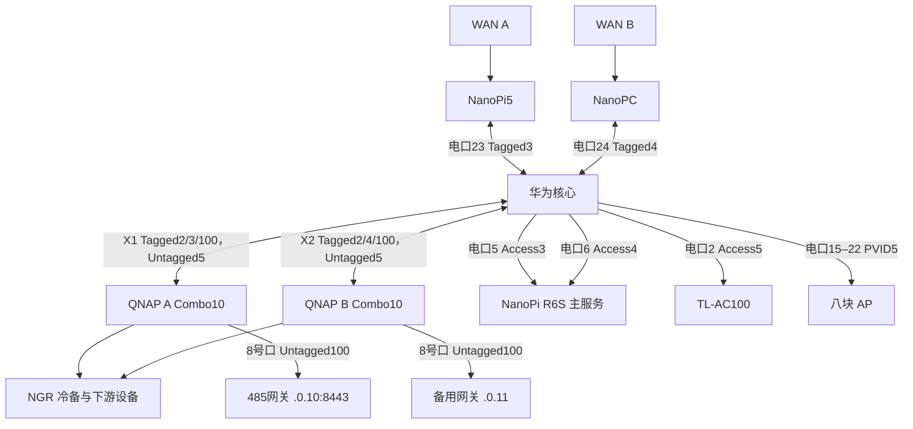

# 知居家庭网络架构

本文说明家庭网络的接线、业务分工及访问边界。操作步骤见[网络配置手册](network-configuration-runbook.md)，HomeSense 服务维护见[NanoPi 指南](../deployment/nanopi/README.md)。实际 MAC、运营商全球 IPv6 前缀、设备导出和凭据保存在私有运维记录。

## 核心与边界

华为 S5735S-L24PN4XE-A3 承载 VLAN2／3／4／5／100 的三层接口。NanoPi5 是 VLAN3／WAN A 边界，NanoPC 是 VLAN4／WAN B 边界；独立 NanoPi R6S 是 HomeSense 主服务器，NGR 为手动冷备。

| VLAN | 用途 | 网关与地址服务 |
| --- | --- | --- |
| 1 | 非现行业务接管网 | Vlanif1 使用 DHCP 取址；维护入口使用独立 VLAN4092 |
| 2 | B组客户端、NGBOSS | 核心`.2.253/24`提供 DHCPv4、PD／RA；公网经 VLAN4 到 WAN B |
| 3 | A组 LAN、NGR 无线、HomeSense | 核心`.3.253/24`路由，NanoPi5`.3.1`提供边界出口与地址服务 |
| 4 | B组边界、服务器、NGX | 核心`.4.253/24`路由；NanoPC`.4.1`提供 DHCPv4、RA 与出口 |
| 5 | AC／AP 管理 | 核心`.5.253/24`及全局池`vlan5_ap`；AC100`.5.1`只管理 AP，不分配地址 |
| 100 | 现用缺省地址设备与维护 | 核心`.0.253/24`及 DHCP；485网关等业务依赖仍使用该网 |

表中`.3.253`表示`192.168.3.253`，其余同理。VLAN3／4由各自边界提供地址服务，核心不重复发布 DHCP 或默认路由 RA。VLAN5 以静默接口发布 OSPF 回程，不建立管理网邻居。

## 接线与标签

| 核心端口 | 对端／用途 | 模式及成员 |
| --- | --- | --- |
| 1、3 | 隔离维护入口 | Access4092 |
| 2 | AC LAN | Access5，PoE关闭 |
| 4 | 停用端口 | shutdown |
| 5 | R6S wan，`.3.3/24` | Access3，PoE关闭，IPv6后缀`::3:3` |
| 6 | R6S lan1／br2，`.4.4/24` | Access4，PoE关闭，IPv6后缀`::4:4` |
| 7 | 停用预留口 | Access1，shutdown，PoE关闭 |
| 8–9、12–13 | 未登记对端 | 保留配置，使用前核对 |
| 10 | VLAN100预留口 | Access100；不代表现用网关已直连该口 |
| 11、14 | VLAN100备用 | shutdown |
| 15–22 | F00／F21／F12／F01／F10／F20／F02／F11 | Trunk PVID5，允许2／3／4／5／100 |
| 23 | NanoPi5 LAN | Trunk，Tagged3，PVID4090，PoE关闭 |
| 24 | NanoPC LAN | Trunk，Tagged4，PVID4091，PoE关闭 |
| X1 | QNAP A Combo10 | Tagged2／3／100，Untagged5，PVID5 |
| X2 | QNAP B Combo10 | Tagged2／4／100，Untagged5，PVID5 |
| X3／X4 | 未接管端口 | 使用前核对实际配置，不按规划直接迁线 |

4090／4091隔离两台边界上联的未标记流量，不提供业务网关或 DHCP。4093／4094已从 X1／X2 移除；4092是带维护入口的独立 VLAN。QNAP 本地6号维护口保留，NAS 使用已登记下游路径；NAS双口和服务器双网卡不跨 VLAN 聚合或桥接。

2026-10-26，核心 X1／X2 的 VLAN5 未标记管理通道已配置并保存，双口仍为10Gbps，OSPF／OSPFv3邻居正常。两台 QSW-M408-4C（QSS 1.3.0）的对应方案为：QNAP10号口 VLAN1 Untagged、PVID1，保留各自业务标签；线上未标记管理帧在核心归入 VLAN5。用户已修改两台QNAP，A／B管理地址分别为`.5.251`／`.5.252`，均已在现有DHCP排除范围内。核心以VLAN5／VLAN3源地址探测均成功，NanoPi5访问两台管理页均返回HTTP200；管理Mac续租后从DHCP ACK自动取得两条主机路由，实际经有线接口与核心`.3.253`访问，两台管理页均返回HTTP200。本次未调整核心访问策略。

AP 管理帧使用未标记 VLAN5，业务 SSID 使用对应标签；Trunk 放行标签不等于 SSID 已启用或客户端已正确获址。维护 SSID 按需启停，不在仓库存放真实 PSK。

## 路由与隔离

| 网段对／服务 | IPv4／IPv6边界 |
| --- | --- |
| VLAN3 ↔ VLAN4 | 允许双向访问 |
| VLAN2 ↔ VLAN4 | 允许双向访问，VLAN2公网经 NanoPC |
| VLAN2 ↔ VLAN3 | 普通访问双向拒绝，保留指定 HomeSense 地址的 TCP8444及回包 |
| VLAN2 → AC | 允许 IPv4 到`.5.1/32` |
| VLAN3 → VLAN100 | 仅指定管理终端、DNS回包与现有 HomeSense 服务连接例外，其余按策略拒绝 |

核心固件将 IPv4 与 IPv6 ACL 放在各自支持的 traffic policy 方向，不能混用分类器。IPv4 主要在 Vlanif2，IPv6 网段对允许在 Vlanif4，并保留 Vlanif3 的附加隔离及 Vlanif100 的来源限制。具体 precedence、当前前缀和管理地址例外在维护时逐项核对。

VLAN3 通过 DHCP Option121获得`192.168.0.0/24 → 192.168.3.253`、AC`.5.1/32`及QNAP`.5.251/32`／`.5.252/32`经核心`.3.253`的路由，默认出口仍为`.3.1`。QNAP两条路由于2026-10-26加入NanoPi5现有IPv4 DHCP配置，客户端续租后生效。指定管理终端使用固定租约，真实绑定不公开。路由可达不代表跨网访问已授权。

## IPv6、DNS与 HomeSense

IPv6来自两条 WAN 的有效 PD。VLAN3 由 NanoPi5 发布 High RA，VLAN2 核心发布 Low RA；核心 Vlanif3 不额外发送 RA。优先级影响主机选择，但不保证所有终端都按同一接口次序选路。

VLAN2 的 RDNSS 指向 NanoPC 当前 VLAN4 前缀加`::4:1`，DNSSL为`lab.vixal.xyz`，寿命1800秒。NanoPC的 LAN Token、DNS通告和域名 AAAA使用同一地址后缀；核心以边界链路本地下一跳维护两侧 LAN 路由及所需 DNS /128路由。

两侧 DNS 的`nanopi.lab.vixal.xyz`提供`.3.3`／`.4.4`和两侧当前 IPv6 地址，`homesense.lab.vixal.xyz`以 CNAME 指向它，TTL为60秒。HTTPS／WSS 使用`https://homesense.lab.vixal.xyz:8444`，证书匹配域名。

HomeSense 主程序监听`.3.3:8444`，附加 socket 透传`.4.4`与两侧 IPv6 的同端口到同一服务。HAP 单桥使用原身份，监听`.3.3:51828`；R6S不承担路由、DHCP或 RA。NGR服务禁用、主角色关闭，定时备份不启动冷备。

R6S 对 VLAN4 IPv6 地址使用独立源地址回程策略：表204／优先级10404，本地 VLAN4 前缀直连，其他目的经 NanoPC 的 VLAN4 链路本地地址。避免请求经 NanoPC、回复却直接跨到 VLAN3，导致连接跟踪丢弃后续 ACK。VLAN3 地址仍使用原路由；PD变化时同步更新该策略、DNS和监听地址，详见[双网入口](../deployment/nanopi/web/README.md)。

IPv6 ACL、静态 AAAA、RDNSS和附加 socket 使用字面地址，PD变化需要人工同步。先按授权保护 VLAN2 转发，再更新前缀、回程、DNS及精确例外，验证后恢复；不能假设它们自动跟随前缀。

## 维护边界

- VLAN100仍承担业务，不能作为纯临时维护网关闭其三层服务或常驻标签。
- NAS、桌面交换机、设备迁址及 QNAP 管理地址变化独立审核，不将规划端口写成已接线。
- 逐 AP 的接入、DHCP／RA、DNS、双栈和隔离分别核对；链路速率或一个终端成功不能代表所有 AP。
- Mac 双网故障先区分全局与接口作用域路由、实际源地址和 DNS路径，不能用另一接口的成功代替故障接口结果。
- 真实配置、首次失败与现场验收日志保留在私有目录；完整软件测试在开发本机执行，目标仅进行必要部署检查。
