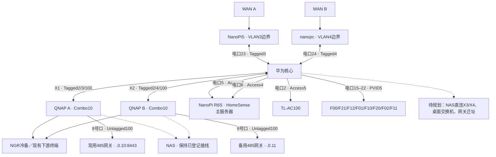

# 知居家庭网络架构

版本1.20 · 2026-10-24整理。本文把当前可核对状态与后续规划分开；操作顺序见[网络配置手册](network-configuration-runbook.md)。本次补充NanoPi R6S双网接入与HomeSense主备切换；NGX修复、VLAN3 DHCP路由与VLAN100管理访问限制继续保留。

## 1 核对范围与当前状态

依据最近的核心配置备份、2026-10-23端口／客户端验收记录，以及2026-10-24的AC100／VLAN5 DHCP接管、F01修复验收和AP端口只读检查整理。15–22号AP口的速率为本次实时读回；其他链路速率仍为此前记录，不据此推定当前在线或长期稳定。

| 项目 | 最近核对状态 | 证据边界 |
| --- | --- | --- |
| 新核心 | 华为S5735S-L24PN4XE-A3，YunShan OS V600R024C10SPC500；承载VLAN2／3／4／5／100现用三层接口 | VLAN1尚非目标业务网关，见下文 |
| WAN A | NanoPi5的Tagged VLAN3 LAN已从QNAP A改接核心电口23；上次2.5G Up、CRC0 | DHCP／RA重新获址仍须另验，不能由路由器自身探测替代 |
| WAN B | nanopc的Tagged VLAN4 LAN直连电口24；上次2.5G Up、CRC0 | 不将边界接口误配成Access口 |
| QNAP A／B | 10号Combo光口分别上联核心X1／X2；上次均10G Up | NAS仍按已登记下游路径使用，不预设已迁到X3／X4 |
| AC／AP | 新TL-AC100接电口2 Access5，旧AC已断开；8块AP位于15–22，当前全部Up | F01的NGR新接入已完成双栈10/10及网页验收，不代替所有AP验收 |
| 旧核心 | Vlanif2／4／100关闭；Vlanif3由用户现场确认关闭，Eth-Trunk4退出；两核心临时VLAN2线已拔 | 不恢复重复网关、DHCP或旧互联线 |
| HomeSense | NanoPi R6S已运行rev52并开机自启，核心5／6口均2.5G，使用当前microSD；NGR禁用且关闭主角色门禁，保留为手动冷备 | 三轮96路只读验收、配对／权限指纹及域名TLS通过；未做动作验收；每小时备份数据到NGR，不启用自动故障切换 |
| 现用485网关 | 仍在VLAN100，HomeSense连接`192.168.0.10:8443`；`.0.10`经QNAP A上联X1，`.0.11`经QNAP B上联X2 | `.1.10:50007`属于历史目标，未启用，不可据旧图修改现网 |
| PE11／EA-5 | PE11仍按原维护地址保留；EA-5不承担当前面板控制 | 不因保留备份接入而恢复Control4执行归属 |

VLAN100仍服务现有`.0.x`设备，不能现在关闭其三层网关或常驻标签。未来迁到纯二层维护前，必须完成所有设备、备份接入和回程依赖的迁移。

2026-10-24已验收：NanoPi5向VLAN3通过DHCP Option121下发`192.168.0.0/24 → 192.168.3.253`，保留AC专用路由和原默认出口。核心Vlanif100出方向限制VLAN3来源，仅允许指定管理Mac，保留DNS回包和现有HomeSense服务连接；管理Mac的有线网卡使用固定DHCP租约。已实测续租自动获路由、允许终端访问成功、其他VLAN3来源被拒绝，核心配置已保存。真实管理地址和MAC只存私有记录。

公开文档只保留拓扑、端口及地址规划。实际MAC、运营商全球IPv6前缀、租约、设备导出、管理凭据和现场配置留在私有运维记录，不提交到仓库。

## 2 业务边界与地址服务

| VLAN | 用途 | 核心／边界分工 |
| --- | --- | --- |
| 1 | 未来A组专用网关接入 | 当前Vlanif1为DHCP取址；隔离维护接口Vlanif4092使用`.1.253`。不能写成业务VLAN1已按目标接管 |
| 2 | B组客户端 | 核心`.2.253/24`提供网关、DHCPv4和IPv6 RA；公网经VLAN4到WAN B |
| 3 | A组LAN、HomeSense | 核心`.3.253/24`路由，NanoPi5`.3.1`提供边界出口及原有地址服务 |
| 4 | B组边界／服务器LAN、NGX无线直入 | 核心`.4.253/24`路由；NGX终端由nanopc`.4.1`直接提供DHCPv4、IPv6 RA和出口，不沿用VLAN2的客户端隔离边界 |
| 5 | AC／AP管理 | 核心`.5.253/24`提供DHCPv4全局池`vlan5_ap`；AC100为`.5.1/24`、网关`.5.253`，关闭自身地址分配服务，仅管理AP |
| 100 | 现有默认地址设备与迁移维护 | 核心`.0.253/24`及现有DHCP仍保留，迁移未完成前不撤销 |

表中`.2.253`表示`192.168.2.253`，其他同理。VLAN3／4各自保留边界LAN地址服务，不能因新增核心三层接口而顺手开启第二套DHCP或默认路由RA。

IPv6由两条WAN的实际PD租约决定，不把某次获得的前缀当成永久值。VLAN2使用经验证的PD／RA配置；核心与边界的路由发布、回程、防火墙和隔离ACL必须与同一代前缀一致。

2026-10-24，两条线路的内网DNS均新增`nanopi.lab.vixal.xyz`：A记录为`192.168.3.3`，AAAA记录为A线当前VLAN3前缀加固定后缀`::3:3`；`homesense.lab.vixal.xyz`以CNAME指向它，三条记录TTL均为60秒。双侧UDP／TCP查询和macOS系统解析已通过；此前NGR记录保留。该域名当前仅登记VLAN3地址，HomeSense已以该域名为HTTPS入口完成切换，见[NanoPi部署记录](../deployment/nanopi/README.md)。运营商前缀变化后，静态AAAA记录须同步更新。

## 3 当前接线与标签

WAN不进入LAN Trunk；NGR的两个LAN聚合口不桥接，也不承担跨VLAN转发。NAS双口继续使用不同IP／VLAN，不做跨VLAN聚合。

| 核心端口 | 当前对端／用途 | 最近配置或读回 |
| --- | --- | --- |
| 1、3 | 隔离维护入口 | Access4092，不能当作已启用的业务VLAN1 |
| 2 | AC LAN | Access5，PoE关闭；上次1G Up |
| 4 | 旧临时VLAN2互联口 | shutdown，物理互联线已拔 |
| 5 | NanoPi R6S的wan，VLAN3 | Access3，PoE关闭，2.5G；`.3.3/24`，RA固定后缀`::3:3` |
| 6 | NanoPi R6S的lan1／br2，VLAN4 | Access4，PoE关闭，2.5G；`.4.4/24`，RA固定后缀`::4:4` |
| 7 | 已撤销的NanoPi预留口 | Access1、shutdown、PoE关闭 |
| 8–9、12–13 | 未完成对端登记 | 保留配置，不凭旧规划插入业务设备 |
| 10 | VLAN100预留口 | Access100；现用`.0.10`经QNAP A接入，不将预留口视为当前接线 |
| 11、14 | VLAN100备用 | shutdown |
| 15 | F00，原F10测试AP | 2026-10-24实时1G Up |
| 16 | F21，原F01设备 | 2026-10-24实时1G Up |
| 17 | F12 | 2026-10-24实时1G Up，端口描述可能仍留旧名 |
| 18 | 最终F01替换AP | 2026-10-24实时2.5G Up；本次速率快照不证明已无断链或新增错误 |
| 19 | 新F10 | 2026-10-24实时2.5G Up |
| 20、21、22 | F20、F02、F11 | 2026-10-24实时均1G Up |
| 23 | NanoPi5 LAN | Trunk，PVID4090，Tagged3，PoE关闭 |
| 24 | nanopc LAN | Trunk，PVID4091，Tagged4，PoE关闭 |
| X1（10GE1/0/1） | QNAP A Combo10 | Tagged2／3／100，PVID4093；最近配置不放行VLAN1 |
| X2（10GE1/0/2） | QNAP B Combo10 | Tagged2／4／100，PVID4094 |
| X3／X4 | NAS直连的历史目标 | 最近配置未完成Access3／4设置，不标为已迁移 |

15–22号AP口均为Trunk PVID5，当前允许VLAN2／3／4／5／100。2026-10-24发现NGX因这些口漏放行VLAN4而无法获址，已仅补充Tagged4；F10／19号口的指定终端新接入后取得VLAN4 IPv4及IPv6，用户确认test-ipv6.com为10/10。PVID5承载未标记管理帧，Tagged业务按实际SSID配置核对；该允许列表与单个终端验收不替代全部AP逐项验收，也不代表VLAN100维护SSID已启用。

4090／4091／4093／4094用于隔离相应Trunk上的未标记帧，不提供业务网关、DHCP或跨口连通。4092是已有维护入口，不能与这些无三层服务的隔离PVID混为一谈。

## 4 隔离与管理入口

VLAN2默认不能直接访问VLAN3／4的普通设备或HomeSense。DNS等必要服务和单机管理入口只按已审核的来源、目的、端口及回包方向放行，不把窄例外扩大为整段互通。

目标固件不能在一个traffic policy中同时使用IPv4和IPv6 ACL分类器。现用结构把IPv4策略放在Vlanif2的入／出方向，把IPv6策略放在Vlanif4的出／入方向。脱敏结构见[双栈隔离示例](../deployment/network/huawei-b-vlan2-vlan4-isolation.cli.example)，不能整份直接下发现网。

B侧四条策略已有success及此前客户端双栈、DNS例外和隔离验收记录；这不是本轮新增的数据面实测。最近配置备份另记录Vlanif3绑定A3_IN6／A3_OUT6，属于A侧附加IPv6隔离，不能用B侧模板覆盖，也不从配置绑定单独推定数据面通过。动态PD变化后，所有相关IPv6 ACL都不会自动引用新前缀；自动检测、自动暂停和更新尚未实现，必须按手册完成前缀变更保护。

Mac同时连VLAN2无线和VLAN3有线时，访问AC或B侧管理地址可能被有线普通路由抢先匹配。此前通过精确主机路由恢复访问；运行时路由、网络服务附加路由与重连后的实际选路须分别核对。不能把经VLAN3成功的公网探测计作VLAN2出口验收。

## 5 已完成、保留与剩余工作

| 范围 | 状态 |
| --- | --- |
| 新核心VLAN2／4接管、QNAP B X2、AC直连 | 已有发布与读回记录 |
| VLAN3／100接管、QNAP A X1、NanoPi5直连 | 已有后续迁线／配置记录；以本页当前表替代早期“未切换”描述 |
| AP最终命名和端口15–22 | 当前8口全部Up，无100M连接；F01的NGR新接入已验收，其他逐AP项目仍按各自证据登记 |
| VLAN5地址服务与AC100接管 | 核心DHCP已启用并保存，AC100仅管理AP；VLAN5通过静默接口发布OSPF回程路由 |
| 网关`.0.10`、PE11及其他`.0.x`迁址 | 未执行；VLAN100继续承担业务 |
| NAS直连、桌面SR-ST3005接入 | 尚未完成，不占用规划端口冒充当前接线 |
| 动态IPv6前缀与隔离ACL同步 | 人工保护流程；自动化未完成 |
| HomeSense接管验收 | 独立跟踪[接管待办](control4-takeover-checklist.md)，网络文档不增加现场通过数 |

2026-10-24的F01故障表现为NGR新接入落入管理VLAN5，而NGBOSS正常进入VLAN2；漫游后保留VLAN3地址不能证明新接入正常。仅重新下发F01的NGR绑定后，抓到带VLAN3标签的客户端DHCP，终端取得VLAN3 IPv4／IPv6，用户确认test-ipv6.com 10/10且网页正常。证据支持“AC记录与F01实际生效状态不一致”，尚不能确定是下发、应用还是固件运行机制失效；详见[修复步骤与验收边界](network-configuration-runbook.md#34-f01的ngr-vlan映射故障与修复2026-10-24)。

## 6 历史记录的解释

2026-10-13的旧核心VLAN1 IPv6分流排障、2026-10-22仅迁B侧的分阶段计划，以及10月23日AP的08:30／09:40／09:48临时接线均属于历史阶段。后来的新核心接管、两条边界直连及最终AP命名已经取代其中的“当前”陈述；原始导出与过程记录保留在私有运维目录。

此前rdhcpd的Renew／Rebind和DAD／RA恢复修复、隔离测试及部署记录继续保留其当时范围，见[续租／RA历史记录](evidence/network/rdhcpd-linux-20261013.json)和[DAD／RA历史记录](evidence/network/rdhcpd-dad-linux-20261013.json)。它们不代替当前核心和逐AP数据面验收；今后的完整测试在开发本机执行，目标侧只做必要部署核对。
