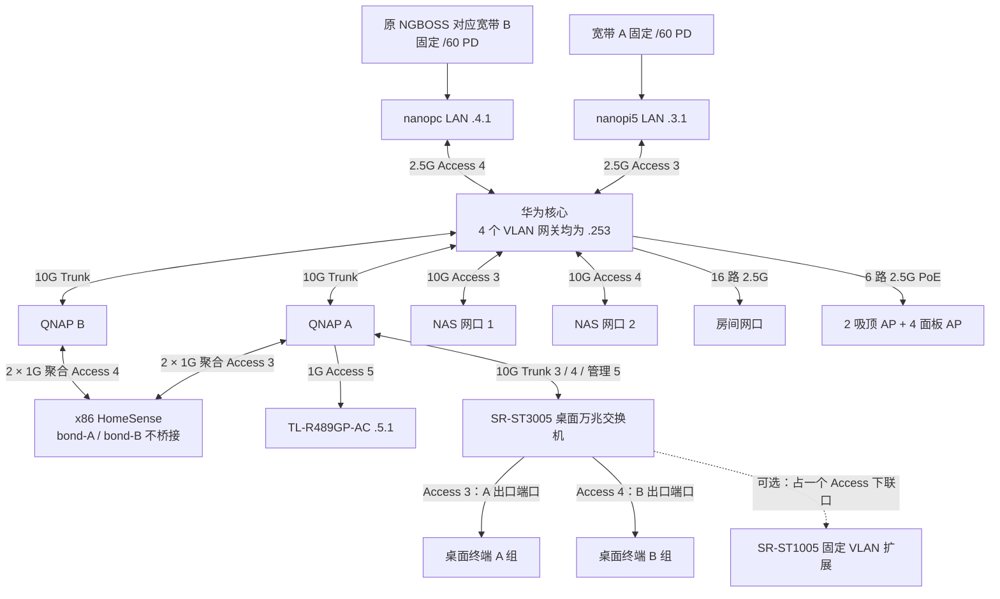

# 知居家庭网络架构设计

版本 1.1，日期 2026 年 10 月 11 日。状态：目标架构已确定；配置为待实机验收的模板，尚未下发。IPv4/IPv6 双流策略同时应用是部署前的关键验证项。

采用华为 S5735S-L24PN4XE-A3 作为核心，统一承担终端网关、跨 VLAN 路由、RA、出口分流和 AP PoE。业务收敛到 VLAN 3、4、100、5。NAS 双万兆直连核心；两台 QNAP 保留，六千兆口 x86 通过两组独立聚合接入，作为 HomeSense 服务器。桌面采用希力威视 SR-ST3005 网管万兆交换机，作为二层 VLAN 接入，通过换插 A/B 端口切换出口。

## 1 设备职责与物理拓扑

| 设备 | 职责 |
| --- | --- |
| S5735S-L24PN4XE-A3 | 核心、16 路房间接入、6 台 AP 供电；24 个 2.5G 电口和 4 个业务万兆光口全部使用 |
| nanopi5 | WAN A 边界，LAN 192.168.3.1；拨号、PD、NAT44、WAN 防火墙 |
| nanopc | WAN B 边界，LAN 192.168.4.1；保留原 NGBOSS Wi-Fi 对应出口路径和边界服务 |
| QNAP QSW-M408-4C × 2 | LAN 侧万兆扩展、x86 千兆聚合接入 |
| 六千兆口 x86 | HomeSense 目标服务器；两口接 QNAP A、另外两口接 QNAP B，分别服务 VLAN 3、4 |
| NAS | 两个独立 IP 的万兆接口，分别在 VLAN 3、4，不做跨 VLAN 聚合 |
| SR-ST3005 桌面网管万兆交换机 | 10G Trunk 上联 QNAP；终端 Access 口按 VLAN 3、4 分组 |
| SR-ST1005 | 保留备用；需要扩展时接 SR-ST3005 的一个 Access 口，下面所有设备共用一个出口组 |
| TL-R489GP-AC | 保留 AC，192.168.5.1；业务采用经验证的本地转发 |
| TL-7AP5100HC-PoE/DC × 2 | 吸顶 AP，由核心供电 |
| TL-7AP5102HI-PoE 薄款 × 4 | 面板 AP，由核心供电 |

核心报价按用户提供的 4468 元记录；新增桌面交换机、光模块和线材另计。核心规格为 400W PoE、1U，机身 442 × 420 × 43.6mm；专用堆叠口不计入业务端口。[华为产品资料](https://e.huawei.com/cn/documents/products/enterprise-network/5e24167930f943f282f9c519eac5b674)



WAN 不进入 LAN Trunk。两台 QNAP 各自单线上联核心；x86 两个聚合接口不桥接、不承担跨 VLAN 转发。保持现有光猫与拨号布线，仅调整规划中的 LAN 链路。

## 2 端口分配

下表是面板位置规划，实际 CLI 接口名以到货设备 `display interface brief` 为准。

| 核心端口 | 对端 | 配置 |
| --- | --- | --- |
| 电口 1–16 | 16 路房间线 | Access 3 或 4；专用 IoT/管理设备按角色用 100/5 |
| 电口 17–18 | 两台吸顶 AP | PoE；管理 VLAN 5，业务 VLAN 3/4/100 按 SSID 放行 |
| 电口 19–22 | 四台面板 AP | 同上 |
| 电口 23 | nanopi5 LAN | Access 3 |
| 电口 24 | nanopc LAN | Access 4 |
| 业务光口 1 | QNAP A | 10G Trunk，基线放行 3/4/5 |
| 业务光口 2 | QNAP B | 10G Trunk，基线放行 4/5；按实际下游增加 3/100 |
| 业务光口 3 | NAS 网口 1 | 10G Access 3 |
| 业务光口 4 | NAS 网口 2 | 10G Access 4 |

端口预算为 16 + 6 + 2 = 24 个电口，2 + 2 = 4 个光口。本期不留核心扩展口；以后需要时将 NAS 接口下移到 QNAP。房间线与 AP 上联按独立线缆计数，现场若复用，应按配线架实际减少用口。

| 扩展设备端口（逻辑规划） | 对端及 VLAN |
| --- | --- |
| QNAP A Combo 1 光口 | 核心，Trunk 3/4/5 |
| QNAP A Combo 2 电口 | SR-ST3005 端口 1，10G Trunk 3/4/5 |
| QNAP A 千兆口 1 | AC，Access 5 |
| QNAP A 千兆口 2、3 | x86 网口 1、2，独立聚合组 A，Access 3 |
| QNAP B Combo 1 光口 | 核心，Trunk 4/5 |
| QNAP B 千兆口 1、2 | x86 网口 3、4，独立聚合组 B，Access 4 |
| x86 网口 5、6 | 备用，不接入形成桥接或额外默认路由 |
| QNAP 其他端口 | 保留现有设备；与规划冲突时调整逻辑编号并记录 |

每个 QNAP Combo 的电口与光口共享一个逻辑端口，不能同时计数。聚合在每台 QNAP 上分别建立，不能把跨两台独立交换机的四条线当成同一个 LACP 组。

如果现有 NAS 或边界 LAN 已使用标签，迁移时协调端点与交换机模式；不能一边保留标签、一边误配 Access。AP 管理 PVID 与标签遵循其实际设置。确认旧 AC 的固件兼容这两种 Wi-Fi 7 AP，且本地转发正常。

## 3 四个 VLAN 与迁移映射

| VLAN | IPv4 网段 | 终端默认网关 | 用途 | 默认出口 |
| --- | --- | --- | --- | --- |
| 3 | 192.168.3.0/24 | 192.168.3.253 | A 组终端、NAS 口 1、x86 聚合 A、nanopi5 LAN | WAN A |
| 4 | 192.168.4.0/24 | 192.168.4.253 | B 组终端、NAS 口 2、x86 聚合 B、nanopc LAN | WAN B |
| 100 | 192.168.0.0/24 | 192.168.0.253 | IoT、HopeBeauty 192.168.0.10 | WAN B |
| 5 | 192.168.5.0/24 | 192.168.5.253 | AC、AP、交换机管理 | WAN B，按需放行 |

旧 VLAN 6 终端迁入 3；旧 VLAN 1、2 终端迁入 4；原 VLAN 100、4 的 B 出口关系保留。迁移静态 IP、DHCP 保留地址、SSID 和端口后，撤销旧 1/2/6 的业务 SVI、地址池与路由发布。设备必须保留的默认 VLAN 1 可留空，不要求强行删除。

所有终端 DHCP Router 选项和静态网关统一改为核心 .253，包括 NAS、x86、管理设备。**边界路由器自身的互联网默认路由仍指向各自 WAN，不能指回核心。**

DHCP 服务可留在现有服务器，但每个 VLAN 只能有已协调的地址池。核对 Option 121 是否包含默认路由；不能只改 Option 3 而被旧 Option 121 覆盖。历史 AC 主机路由 `.5.1/32 via .3.253` 在统一网关后通常不再需要，先确认其他用途再移除。[原中控设计](design.md)

保留核心 OSPFv2 进程 1、Router ID 10.0.0.6、区域 0.0.0.0；邻居 `.3.1`（RID 10.0.0.3）与 `.4.1`（RID 10.0.0.4）恢复 Full。现有默认路由为 O_ASE 经 `.4.1`，保留作为常规 B 出口。只发布仍使用的网段，核查原 `192.168.0.0/16 → NULL0` 的汇总与重分发用途，不盲目删除或重建。

## 4 IPv4 出口策略模板

处理顺序：访问限制 → 内网目的按路由表 → 可选单机例外 → VLAN 3 源走 A → VLAN 4/100/5 源走 B。内网豁免不是安全放行规则；正式配置须合并已有隔离策略。VPN、远端内网若存在，也要补入目的豁免与正常路由。

以下 ACL 编号和策略名需先检查冲突。语法基于华为 V600R024C10 文档；策略定义与实际绑定分开，绑定限制见第 6 节。[重定向配置](https://support.huawei.com/enterprise/zh/doc/EDOC1100459022/93a2f4f2)

```text
acl 3000
 rule 5 permit ip destination 192.168.0.0 0.0.0.255
 rule 10 permit ip destination 192.168.3.0 0.0.0.255
 rule 15 permit ip destination 192.168.4.0 0.0.0.255
 rule 20 permit ip destination 192.168.5.0 0.0.0.255
 quit
acl 3001
 rule 5 permit ip source 192.168.3.0 0.0.0.255
 quit
acl 3002
 rule 5 permit ip source 192.168.4.0 0.0.0.255
 rule 10 permit ip source 192.168.0.0 0.0.0.255
 rule 15 permit ip source 192.168.5.0 0.0.0.255
 quit
traffic classifier V4_LOCAL type or
 if-match acl 3000
 quit
traffic classifier V4_A type or
 if-match acl 3001
 quit
traffic classifier V4_B type or
 if-match acl 3002
 quit
traffic behavior V4_ROUTE
 permit
 quit
traffic behavior V4_TO_A
 redirect nexthop 192.168.3.1 fail-action discard
 quit
traffic behavior V4_TO_B
 redirect nexthop 192.168.4.1 fail-action discard
 quit
traffic policy V4_EGRESS
 classifier V4_LOCAL behavior V4_ROUTE precedence 10
 classifier V4_A behavior V4_TO_A precedence 30
 classifier V4_B behavior V4_TO_B precedence 40
 quit
```

可选 IPv4 单机例外：将保留地址 `192.168.3.50` 的桌面设备改走 B，保持其 IPv4 地址不变。该地址仅为示例，使用前确认未占用。

```text
acl 3013
 rule 5 permit ip source 192.168.3.50 0
 quit
traffic classifier V4_DESK_B type or
 if-match acl 3013
 quit
traffic policy V4_EGRESS
 classifier V4_DESK_B behavior V4_TO_B precedence 20
 quit
```

切回 A 时撤销该主机的匹配规则，保留其他主机例外。此方案**只切 IPv4**，IPv6 仍按原源前缀走 A；完整双栈切换使用第 8 节换 VLAN 的方案。

## 5 IPv6 前缀、RA 与分流

`2001:db8::/32` 全部是文档地址，不可用于实际公网。A 示例 PD 为 `2001:db8:1000:1000::/60`，B 为 `2001:db8:2000:2000::/60`。一个 /60 包含 16 个 /64；按实际前缀计算子网偏移，不能任意拼接字符串。

| VLAN | 发布的唯一 /64 | 核心地址 | 边界地址 |
| --- | --- | --- | --- |
| 3 | 2001:db8:1000:1003::/64（A 偏移 3） | 2001:db8:1000:1003::253 | nanopi5：2001:db8:1000:1003::1 |
| 4 | 2001:db8:2000:2004::/64（B 偏移 4） | 2001:db8:2000:2004::253 | nanopc：2001:db8:2000:2004::1 |
| 100 | 2001:db8:2000:2000::/64（B 偏移 0，按需启用） | 2001:db8:2000:2000::253 | 无 |
| 5 | 首期 IPv4 管理，不发布 RA | 无 | 无 |

每个业务 VLAN 只发布对应出口的一个前缀，避免普通终端任意选择另一条线路。核心为唯一 RA 发布者；边界停止对应 LAN 的 RA，不从 LAN 学习默认路由，保留 WAN PD 续租。终端学习的 IPv6 默认网关通常是核心链路本地地址，不是手填 ::253。

### 5.1 RA 模板

```text
interface Vlanif3
 ip address 192.168.3.253 255.255.255.0
 ipv6 enable
 ipv6 address 2001:db8:1000:1003::253 64
 ipv6 nd ra prefix default no-advertise
 ipv6 nd ra prefix 2001:db8:1000:1003:: 64 7200 3600
 ipv6 nd ra max-interval 200
 ipv6 nd ra min-interval 60
 ipv6 nd ra router-lifetime 600
 ipv6 nd ra halt disable
 quit
```

Vlanif4 同样设置 `.4.253`、`2001:db8:2000:2004::253/64` 和对应 RA；Vlanif100 按需设置 `.0.253`、`2001:db8:2000:2000::253/64`。各接口只发布表中自己的 /64，RA 启用命令在回程、PBR 验证完成后执行。

7200/3600 秒为有效期/首选期示例，不得超过 PD 剩余授权期。固定前缀仍有租约。SLAAC 的 M/O 标志保持关闭，除非已有相应 DHCPv6 服务。DNS 使用实际 DNS 服务的 RDNSS 或现有 DHCPv4 下发；核心路由地址不会自动成为 DNS 服务器。[RA 属性](https://support.huawei.com/enterprise/zh/doc/EDOC1100459025/73a81c9a)、[启用 RA](https://support.huawei.com/enterprise/zh/doc/EDOC1100459025/e317010b)

### 5.2 IPv6 策略定义

只把实际启用的内网 /64 放入目的豁免；若 VLAN 100 未启用 IPv6，删去其目的规则和相关回程。不要用 ACL deny 表达“跳过 PBR”，这里使用正常转发行为。[ACL6](https://support.huawei.com/enterprise/zh/doc/EDOC1100459025/f8718c03)、[MQC permit/deny](https://support.huawei.com/enterprise/zh/doc/EDOC1100459022/64159c7c)

```text
acl ipv6 3100
 rule 5 permit ipv6 destination 2001:db8:1000:1003:: 64
 rule 10 permit ipv6 destination 2001:db8:2000:2004:: 64
 rule 15 permit ipv6 destination 2001:db8:2000:2000:: 64
 quit
acl ipv6 3101
 rule 5 permit ipv6 source 2001:db8:1000:1000:: 60
 quit
acl ipv6 3102
 rule 5 permit ipv6 source 2001:db8:2000:2000:: 60
 quit
traffic classifier V6_LOCAL type or
 if-match ipv6 acl 3100
 quit
traffic classifier V6_A type or
 if-match ipv6 acl 3101
 quit
traffic classifier V6_B type or
 if-match ipv6 acl 3102
 quit
traffic behavior V6_ROUTE
 permit
 quit
traffic behavior V6_TO_A
 redirect ipv6 nexthop 2001:db8:1000:1003::1 fail-action discard
 quit
traffic behavior V6_TO_B
 redirect ipv6 nexthop 2001:db8:2000:2004::1 fail-action discard
 quit
traffic policy V6_EGRESS
 classifier V6_LOCAL behavior V6_ROUTE precedence 10
 classifier V6_A behavior V6_TO_A precedence 30
 classifier V6_B behavior V6_TO_B precedence 40
 quit
ipv6 route-static :: 0 2001:db8:2000:2004::1
```

核心本机流量不等同于终端入方向 PBR，本机公网访问使用 B 的源地址与默认出口。用终端验证分流，不能仅凭核心 ping 下结论。

## 6 策略绑定与硬件转发验证门槛

官方要求 IPv4、IPv6 分类分别配置流策略。该型号所属 S5735S-L3 的应用层级存在端口 > VLAN > VLANIF > 全局的优先关系；不能假定放到不同层级就能叠加生效。当前查阅的资料未明确确认该型号同一 Vlanif 入方向同时承载两套独立双栈策略的具体方式。[流分类](https://support.huawei.com/enterprise/zh/doc/EDOC1100459022/7b8eba15)、[策略应用](https://support.huawei.com/enterprise/zh/doc/EDOC1100459022/53fc6a8)、[型号限制](https://support.huawei.com/enterprise/zh/doc/EDOC1100459022/7b4f6521)

下面是**仅供实验验证的候选绑定**，不是已确认适用于该型号的生产脚本：

```text
interface Vlanif3
 traffic-policy V4_EGRESS inbound
 traffic-policy V6_EGRESS inbound
 quit
```

先要求卖家或华为支持提供该型号、实际固件版本下双栈同时生效的配置与测试证据，再在隔离环境验证：第二条不替换第一条、两套策略均成功下发、IPv4 和 IPv6 分别命中且出口正确。验证通过后，以该固件支持的方式覆盖 VLAN 3、4、100；VLAN 5 首期仅需 IPv4。

如果该绑定不支持，应取得官方支持的替代应用方式并复测；不能直接上线，也不能把“能输入命令”当作成功。本设计暂不以未经验证的混合 IPv4/IPv6 单策略替代。

安全 ACL 与 PBR 的组合、URPF 限制、TCAM 资源、内网豁免停止后续重定向的效果均需验证。检查命令按实际版本补全参数：

```text
display version
display traffic-policy applied-record
display system tcam fail-record
display system tcam service traffic-policy
display traffic-policy statistics
```

只有下发成功并经过实际跨 VLAN/PBR 吞吐和 CPU 测试，才能认定本组配置满足硬件转发要求；本文件不承诺所有组合线速。

## 7 边界回程、NAT 与链路故障

两台边界保留各自 WAN 默认路由。IPv4 通过原 OSPF 学习其他三个内网网段，或配置经各自核心 `.253` 的具体静态回程，不能同时遗漏回程又只加默认路由。

| 边界 | IPv4 非直连内网回程经核心 | NAT44 来源 |
| --- | --- | --- |
| nanopi5 A | 192.168.0.0/24、192.168.4.0/24、192.168.5.0/24 → 192.168.3.253 | 192.168.3.0/24 |
| nanopc B | 192.168.0.0/24、192.168.3.0/24、192.168.5.0/24 → 192.168.4.253 | 192.168.4.0/24、192.168.0.0/24、192.168.5.0/24；启用单机例外时加相应来源 |

边界转发规则要允许核心下游子网，不能只允许边界自身的直连 LAN。IPv6 使用运营商授权前缀，无 NAT66：

| 边界 | IPv6 静态回程（仅启用的网段） |
| --- | --- |
| A | B 的 VLAN 4、100 两个 /64 → 2001:db8:1000:1003::253 |
| B | A 的 VLAN 3、B 的 VLAN 100 两个 /64 → 2001:db8:2000:2004::253 |

本机直连前缀无需再加静态。两边都维护内网回程，保证边界 DNS 等本机服务能回复跨 VLAN 客户端。不能把未分配的整个 /60 指回核心形成默认路由环路。需要动态回程时改用经验证的 OSPFv3，只发布实际 /64；它不替代源前缀分流。[OSPFv3 型号范围](https://support.huawei.com/enterprise/zh/doc/EDOC1100459029/40985183)

四 VLAN 方案把边界和部分终端放在同一网段，因此回包可能由边界直接二层送到终端，不经过核心。这是已知的不对称路径，WAN 状态防火墙保留在边界。检查并抑制核心发出的 ICMP/ICMPv6 Redirect，避免终端学到绕过核心的互联网下一跳；对应命令依实际固件确认。

`fail-action discard` 只在重定向下一跳不可用时控制回落；边界 LAN 仍在线而 WAN 断开时，它不是完整线路探测。A 的 IPv6 源前缀不能直接改走 B。固定出口 VLAN 本期没有自动双线故障切换；桌面可换到另一出口的端口重新取地址。连接需要重建。

更换 PD 时同步修改边界地址、核心 SVI/RA、源前缀 ACL、目的豁免、下一跳、回程、防火墙和 DNS。旧前缀首选期降为 0 仅在正确的过渡授权下使用，不能继续通告已被运营商撤销的前缀。

## 8 桌面设备完整切换 WAN

桌面型号采用 **希力威视 SR-ST3005**，经 QNAP A 的 Combo 2 万兆电口上联，不新增核心端口。官网列出 5 个 10G RJ45 口、1 个 Console 口，以及 Web、802.1Q VLAN、LACP；本方案只用二层交换和 VLAN，不启用业务 VLAN 间路由、DHCP 或 RA，终端网关继续由核心承担。[SR-ST3005 官方产品页](https://cloud.sirivision.com/official-website/products/7/67)

官网当前没有该型号的下载手册，尚未逐项核实实际固件的 Tagged/Untagged、PVID 与独立管理 VLAN 页面。采购前请卖家提供这些配置页面及保存重启后的保留结果；不能只凭“三层网管”字样认定全部配置细节已验证。

| SR-ST3005 端口（规划编号） | VLAN 配置 | 用法 |
| --- | --- | --- |
| 1 | Trunk，Tagged 3、4；独立管理支持时加 5 | 10G 电口接 QNAP A Combo 2，两端标签一致 |
| 2、3 | Untagged 3，PVID 3，移除无关 VLAN 成员 | A 出口设备；也可预留其中一口供换插 |
| 4、5 | Untagged 4，PVID 4，移除无关 VLAN 成员 | B 出口设备；也可预留其中一口供换插 |

5 个业务口中 1 个用于上联，剩余 4 个用于终端。Console 不计为网络口。保留空闲的另一出口端口才能方便换插；也可按实际设备数量调整 A/B 口数。交换机支持独立管理 VLAN 时用 5，否则用受控业务 VLAN 管理并限制来源。

旧 SR-ST1005 首期可不连接，作为备用；需要扩展时，接到端口 2–5 中任意一个，替代该口直连终端的位置。它下面所有设备继承该端口的单一 VLAN，不能各自通过换 SR-ST1005 的端口切换出口。桌面所有跨上联流量共享这条 10G 链路；本方案不使用 LACP 占用额外端口。

切换操作：将电脑网线从 A 口换到 B 口，触发链路重连与 DHCP 更新，等待新 RA/SLAAC；确认旧 IPv6 地址和默认路由不再被选用，必要时重置该网卡网络连接。此时 IPv4 从 `.3.x/.3.253` 变为 `.4.x/.4.253`，IPv6 从 A 前缀变为 B 前缀。分别检查 IPv4、IPv6 公网出口，应用重新连接；不承诺现有会话无感延续。

也可在 Web 管理中改同一个终端端口的 Untagged 成员和 PVID，再触发终端网络更新；仅改 PVID 不足以保证收发一致。独立端口切换只影响该端口设备，改 SR 上联的 VLAN 则影响 SR 下所有设备。不要把 A、B 两个 Access 口同时接入 SR-ST1005，会混接两个广播域。

## 9 x86 HomeSense 服务器

### 9.1 接入与地址

沿用现有两组双千兆聚合：组 A 连接 QNAP A 并承载 VLAN 3，组 B 连接 QNAP B 并承载 VLAN 4。具体聚合模式尚未提供，先导出两端配置：若是 LACP，服务器和各 QNAP 对应组均保持 802.3ad；若是静态聚合或主备，按现有模式核对，不能单方面切换。

服务器上 IP 配在聚合逻辑接口，成员物理接口不另配业务 IP。每组两条千兆链路提供链路冗余；LACP 多流合计带宽可接近 2Gbps，单流通常仍限一条千兆链路，具体取决于哈希。两组不构成跨交换机故障接管。[Linux bonding 官方说明](https://docs.kernel.org/networking/bonding.html)

| 接口逻辑名（示例） | VLAN | IPv4 示例 | 用途 |
| --- | --- | --- | --- |
| bondA | 3 | 192.168.3.20/24 | A 组客户端服务 |
| bondB | 4 | 192.168.4.20/24 | B 组客户端服务、默认主动访问出口 |

`.20` 仅为配置示例，优先保留现有静态地址并排除 DHCP 冲突。HomeSense 不需要两张网卡才能跨 VLAN 服务，但此方案复用现有接线与两网段服务方式。CPU、内存、磁盘未提供，网络接入可行不代表已完成运行容量与可靠性验收。

### 9.2 服务器回程策略

主路由表只保留一个普通默认路由，建议经 bondB 到 `192.168.4.253`。主动发起的 HopeBeauty 连接、更新和外部访问默认使用 B；若应用绑定 A 地址，则用源地址策略表经核心 `.3.253`。不要在主表放两条无区分的同优先级默认路由。

以下为 Linux 临时路由示例，假设接口名、地址均已按上表配置，表号 103/104 和规则优先级尚未占用。它不负责创建聚合，也不是可直接导入未知系统的持久配置：

```sh
ip route replace default via 192.168.4.253 dev bondB
ip route replace table 103 192.168.3.0/24 dev bondA src 192.168.3.20
ip route replace table 103 192.168.4.0/24 dev bondB src 192.168.4.20
ip route replace table 103 default via 192.168.3.253 dev bondA
ip route replace table 104 192.168.3.0/24 dev bondA src 192.168.3.20
ip route replace table 104 192.168.4.0/24 dev bondB src 192.168.4.20
ip route replace table 104 default via 192.168.4.253 dev bondB
ip rule add priority 1030 from 192.168.3.20/32 table 103
ip rule add priority 1040 from 192.168.4.20/32 table 104
```

两张表都保留两个直连网段，避免本地请求绕行网关；其他内网目的到核心后命中内网豁免，外网按源地址选择出口。按实际服务源地址验证 `ip route get <客户端地址> from <服务地址>`；新增 VPN、容器网段也要协调其路由。重复执行 `ip rule add` 前检查旧规则，最终持久化到实际网络管理器。

服务器首期可只承载 IPv4 服务。若启用两组 IPv6 地址，应为每个服务源地址设置对应源路由表：包含两条直连 /64，默认分别经 A/B 网段的核心 ::253；同时控制自动 RA 默认路由，不能仅依赖两个接口收到 RA 后的默认优先级。动态/隐私地址启用时同步规则或对实际接口前缀制定规则。NAS 双接口也应检查同类回程和默认路由问题。

服务器不桥接 VLAN 3/4，不启用不需要的 IPv4/IPv6 转发、NAT、DHCP 或 RA。容器/虚拟化平台可能自动开启转发，需检查实际配置。若严格 IPv4 rp_filter 与合法多宿主路径冲突，可在相关接口评估 loose 模式并保留来源过滤，不能一律关闭检查。[Linux IP sysctl](https://www.kernel.org/doc/html/latest/networking/ip-sysctl.html)

### 9.3 服务监听、发现与迁移

优先运行一个 HomeSense 运行实例，保留一套设备状态与配对身份；不要因两个网段启动两个同时控制相同硬件的独立实例。实际程序是否支持两个监听地址、双接口 mDNS 发布须从所部署版本验证，不能默认绑定 `0.0.0.0` 就解决所有问题。

如果当前版本仅稳定支持单 LAN 监听，可先将服务绑定 VLAN 4 地址，让 VLAN 3 客户端经核心访问，并在必要范围提供 mDNS 转发；等双接口发布验证通过再同时服务两个本地网段。服务器双网口不是跨 VLAN mDNS 反射器。

[nanopc 部署记录](../deployment/nanopc/README.md)曾记录 mDNS 使用默认组播接口及枚举多个地址的问题。它是历史证据，不代表当前代码一定仍有问题。需要分别在 VLAN 3、4 验证发现记录、可达的 SRV/A/AAAA、配对与实际控制；不要只测试 TCP 端口。

从 nanopc 迁移时备份配置、身份和配对数据、自动化状态及运行目录；构建适合 x86 的二进制。停止旧实例后启用新实例，避免同一身份双活和重复控制。保留 nanopc 的 PPPoE、rproxy、rdhcpd、OSPF 等边界服务。新旧地址变化同步更新访问规则、发现信息和监控。

HomeSense 到 `192.168.0.10:50007` 的路由及允许规则继续保留，验证 IoT 网关回复核心 `.0.253`。HAP 服务端口以运行实例为准，历史 51826/51827 不当作永久常量。[中控设计](design.md)

## 10 迁移、验收与回退

1. 备份旧核心、边界、QNAP、AC、NAS、x86 的网络与服务配置。记录每条线、聚合模式、静态地址和 DHCP 选项。
2. 离线验证实际华为型号/固件的双栈策略绑定、ACL/PBR 下发与吞吐，未通过前不替换生产核心。
3. 准备四 VLAN、端口、网关、IPv4 PBR、OSPF、边界 NAT/回程；先断开旧核心再启用相同 .253/RID 的新核心。
4. 分批把旧 VLAN 6 迁入 3、旧 1/2 迁入 4，更新终端网关、地址池与 SSID。确认无依赖后撤销旧业务 SVI。
5. NAS 接核心、x86 保留两组 QNAP 聚合，测试所有 IPv4 业务。新增桌面交换机先验证标签与 A/B 端口切换。
6. 完成 IPv6 回程和策略后逐 VLAN 开启单前缀 RA。管理 VLAN 5 不开 RA，IoT 按需启用。
7. 单独迁移 HomeSense；网络验收与服务身份迁移分步骤进行，避免难以定位故障。保存配置并复验重启、续租和断链。

| 验收项 | 通过条件 |
| --- | --- |
| 物理/PoE | 核心 24 电 + 4 光与表一致；NAS/QNAP 10G；路由器/AP 协商正常；6 AP 同时稳定供电 |
| VLAN/网关 | 仅四个业务 VLAN；所有终端 IPv4 默认网关为各自 .253；无旧 DHCP/Option 121 干扰 |
| OSPF/回程 | .3.1、.4.1 邻居 Full，四个内网路由完整；默认出口 B；IPv6 回程完整 |
| 双栈 PBR | IPv4、IPv6 策略同时有效，规则与 TCAM 下发成功；A/B 分别符合真实公网出口 |
| 内网/安全 | NAS、AC、HomeSense、HopeBeauty 可达；内网不绕 WAN；IoT/管理访问限制双栈一致 |
| RA | 每个业务 VLAN 只有指定前缀与核心 RA，无边界竞争 RA；旧地址/默认路由正确清理 |
| 桌面换口 | A→B→A 后 IPv4 与 IPv6 都切换，新会话可用；其他端口不受影响 |
| x86 聚合 | 每组模式一致；每根成员线依次断开可恢复；多流与单流表现合理，无跨 VLAN 桥接 |
| x86 多宿主 | 两网段访问、跨网段回复和绑定源地址出网正确，无错误默认路由或 rp_filter 丢包 |
| HomeSense | 一套有效身份；两个客户端 VLAN 均发现、配对、控制正常，旧实例停止；IoT TCP 50007 回程正常 |
| IPv6/故障 | 必要 ND/ICMPv6/Packet Too Big 放行；两 WAN 的 PMTU 正常；断线不误用另一运营商源前缀 |
| 持久化 | 设备重启、PD 续租后保持；文档记录实际接口名、固件、地址与测试结果 |

回退时隔离新核心，恢复旧核心和原布线、DHCP、边界路由。不要同时运行重复 .253 网关/RID。IPv6 停止 RA 不会立即撤销终端已有地址，应按生命周期及终端状态处理。HomeSense 回退先停 x86 实例，再恢复旧运行目录和实例，避免双活。

## 11 采购及部署前尚需确认

- 华为完整型号、固件版本、与该版本匹配的手册；同入口双栈 PBR 的实际可用应用方式和硬件测试证据。
- ACL/PBR 组合资源、URPF 和 Redirect 配置；管理协议与来源限制。
- 光模块/DAC、NAS 原光连接兼容性；机柜深度与散热；SR-ST3005 的 Tagged/Untagged、PVID、管理 VLAN、配置持久化，以及桌面摆放时的风扇噪声和散热。
- 旧 AC 对现有 AP 的兼容性、本地转发、SSID 与管理标签。
- 真实固定 /60、PD 生命周期、边界持久配置方式与 2.5G 网卡能力。
- x86 操作系统、CPU/内存/磁盘、两组聚合现行模式、实际接口和服务 IP、容器使用情况；HomeSense 版本及双接口发现验证。

本文已纳入用户确定的接线和 VLAN 选择，但上述固件行为与现场参数仍待验证。所有模板只描述目标配置，不代表已实施或已通过硬件转发验收。
